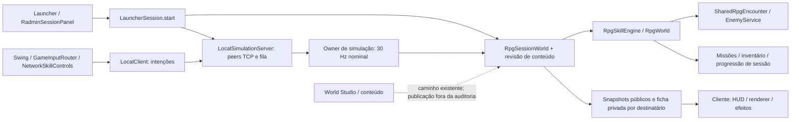

# ALPHA-001 — Adendo de correspondência com o plano v1.0

Data: **17/11/2026**, America/Sao_Paulo. Referência: “OPERAÇÃO ALPHA — ALPHA-001 — Plano de auditoria de prontidão (v1.0, 17/11/2026)” fornecido pelo responsável nesta conversa.

Este adendo complementa os cinco documentos já entregues, sem substituir seus resultados. Organiza a auditoria nas **14 trilhas T01–T14** do novo plano, acrescenta o diagrama de responsabilidades e explicita a lacuna de licenças/proveniência e os papéis de decisão. Não inicia implementação, ALPHA-002…008, TASK-226 ou integração de persistência.

## Resultado e baseline reconfirmado

Recomendação mantida: **NÃO LIBERAR**. A-04 permanece **BLOQUEADO / P0**; a jornada completa e a homologação física não foram comprovadas.

Raiz: `C:/Users/lucas/Documents/GitHub/Projeto-K`. Branch `beco`; HEAD `c3d484e76f17c2d93bf0c68ad3ff54280ee8ad39`. Na entrada deste adendo: **55 entradas não rastreadas**, sem diff rastreado, incluindo os cinco documentos ALPHA-001 anteriores e as 50 entradas da primeira auditoria. A lista destas últimas está no [relatório original](ALPHA-001-RELATORIO-AUDITORIA.md). Nenhum desses arquivos foi descartado.

Java novamente consultado: Temurin 17.0.20.1; Maven 3.10.0; release 17 em [server/pom.xml](../server/pom.xml). Um módulo Maven identificado, contendo os caminhos de cliente, servidor e Studio já inventariados no relatório.

As instruções AGENTS/skill local, o Plano Diretor histórico em `.task-checkpoints/CORUJAO-IX/TASK-223/user-directive.txt` e o plano técnico já lidos continuam aplicáveis. O novo plano preserva as mesmas restrições de auditoria; não foi identificada autorização de patch ou execução das etapas futuras.

Monitor novamente consultado: registro antigo, fase aguardando e listas vazias; isso não prova atividade do processo nem resolução de erros. Relação de TXT permaneceu com os registros de 01/11 e 08/11 já contextualizados. Nenhum atendimento corretivo foi iniciado.

Inventário de preservação deste adendo: **3.828 arquivos existentes** obtidos das listas Git rastreada/não rastreada, com hashes SHA-256 guardados em memória. Inclui os cinco relatórios anteriores. Ignorados, arquivos inacessíveis e dados pessoais não estão cobertos por esse inventário.

## Como consultar a entrega

| Necessidade do plano v1.0 | Documento que contém a evidência |
|---|---|
| Baseline, método, inventário e divergências | [Relatório](ALPHA-001-RELATORIO-AUDITORIA.md) |
| Componentes, métodos, estados históricos versus Alpha, testes e riscos | [Matriz detalhada: 24 linhas](ALPHA-001-MATRIZ-PRONTIDAO.md) |
| 40 skills, oito kits, domínios, custos, recargas, efeitos, assets e ressalvas | [Mapa de skills e direções](ALPHA-001-MAPA-SKILLS-E-DIRECOES.md) |
| Raça × ação × direção e chamada efetiva do renderer | Mesmo mapa: 192 combinações explícitas |
| A-03/A-04, critérios objetivos, alternativas e sequência futura | [Riscos e gates](ALPHA-001-RISCOS-GATES.md) |
| Jornada, testes físicos, duas sessões A/B, métricas e ficha | [Roteiro de homologação](ALPHA-001-ROTEIRO-HOMOLOGACAO.md) |
| Correspondência T01–T14, diagrama, licenças e papéis de decisão | Este adendo |

## Matriz de correspondência T01–T14

Estados usados: **IMPLEMENTADO, TESTADO, PENDENTE, BLOQUEADO, NÃO VERIFICADO**, conforme o novo plano. Não substituir implementação por um plano ou aprovação por existência de teste. As conclusões atuais abaixo são de **17/11/2026**; datas e resultados históricos são os dos relatórios vinculados na matriz detalhada.

A coluna de escopo separa a leitura atual dos ensaios anteriores. TESTADO histórico significa resultado documentado no checkout da ocasião; não certifica o HEAD atual. Os resultados de arquivos da primeira coleta continuam válidos como inventário estático preservado, sem contar a revisão deste adendo como novos testes de assets.

| Trilha | Estado histórico/documentado | Situação Alpha 0.1 | Escopo da prova e referência atual | Resultado / limitação | Prioridade / fechamento |
|---|---|---|---|---|---|
| T01 Arquitetura e governança | IMPLEMENTADO | IMPLEMENTADO | Leitura atual: [LocalSimulationServer.start, linhas 10–38](../server/src/main/java/com/projetok/multiplayer/LocalSimulationServer.java#L10); POM; diagrama abaixo. Testes TCP históricos na matriz detalhada | Owner único e limites de filas identificáveis; framing base 1 e aplicações 6/7. Não há execução atual de thread/tick ou certificação completa de autoridade | P1; regressão segura e confirmação de fronteiras |
| T02 Criação e sessão inicial | TESTADO | NÃO VERIFICADO | Leitura: [RpgSessionWorld.join/joinCharacter](../server/src/main/java/com/projetok/multiplayer/RpgSessionWorld.java#L161), [NetworkPlayerVisuals.renderInfo](../server/src/main/java/com/projetok/multiplayer/NetworkPlayerVisuals.java). Testes raciais históricos na matriz | Quatro raças e criação efêmera; Human provisório para Aetheri/Spirit; onboarding/jornada não executados | P1; criar/entrar por cada papel no candidato |
| T03 Multiplayer | TESTADO | PENDENTE | Leitura: [LocalSimulationServer](../server/src/main/java/com/projetok/multiplayer/LocalSimulationServer.java#L10), [LauncherSession.start/managed](../server/src/main/java/com/projetok/prototype/rpg/LauncherSession.java#L26). TCP R2 histórico | Capacidade dois, guard de guest e snapshots; guest não é autenticação do JAR. Dois PCs não homologados | P1, P0 se conexão impossível; ensaio A/B |
| T04 Combate e skills | TESTADO | NÃO VERIFICADO | Inventário estático de 40 IDs/71 clips; [RpgSkillEngine.cast](../server/src/main/java/com/projetok/rpg/RpgSkillEngine.java); matriz 40× com testes identificados | 24 sem/16 com ressalvas na 223; custo/recarga/targeting presentes. A-04 tratado separadamente como bloqueio, sem aprovar o combate integral | P1 geral, P0 A-04; critérios por ID |
| T05 Arte e oito direções | TESTADO | IMPLEMENTADO | Inspeção estática: 56 hashes raciais e geometria de 71 clips; [eightDirections, linha 697](../server/src/main/java/com/projetok/rpg/RpgSkillEngine.java#L697); [RemoteSpriteAnimation.pose](../server/src/main/java/com/projetok/multiplayer/RemoteSpriteAnimation.java); matriz 192× | Vetores de skill em oito sentidos; corpo em quatro poses IDLE/WALK. Arte adicional, render/efeitos e avaliação humana NÃO VERIFICADO; não há shader específico demonstrado | P2 arte, P1 se prejudicar leitura/controle; aceite humano |
| T06 Inimigos e IA | TESTADO | NÃO VERIFICADO | Leitura: [SharedRpgEncounter.stepRegion](../server/src/main/java/com/projetok/rpg/SharedRpgEncounter.java#L99), [MobNavigation.route](../server/src/main/java/com/projetok/rpg/MobNavigation.java#L16). Testes IA/colisão na matriz | Spawn, alvo, navegação limitada, dano, morte e respawn têm caminhos; interação real dos dois jogadores e carga não executadas | P1; mapa candidato, obstáculos, leash e dois alvos |
| T07 Jornada e conteúdo | TESTADO | PENDENTE | Leitura: [corujao-v.sgquest](../server/src/main/resources/rpg/corujao-v.sgquest), [RpgSessionWorld.enableRevisions](../server/src/main/java/com/projetok/multiplayer/RpgSessionWorld.java#L150). Regressões R1 históricas | coop_slime dá uma potion, sem XP/moedas próprios; piso 10.000 versus fixture 40 HP; acesso ao domínio no nível 15. Percurso de 20–30 min não comprovado | P1; selecionar conteúdo/perfil e cronometrar |
| T08 Interface e UX | TESTADO | PENDENTE | Leitura: [GameInputRouter.reset/refreshContext](../server/src/main/java/com/projetok/multiplayer/GameInputRouter.java), [NetworkSkillSubmission](../server/src/main/java/com/projetok/multiplayer/NetworkSkillSubmission.java). GUI histórica 224/ORG-02 | Prévia não é ACK por comando; intermitência de foco sem correção comprovada. Teclado humano, áudio e resize não executados | P1 controles, P2 acabamento; roteiro físico |
| T09 Launcher e distribuição | TESTADO | PENDENTE | Inspeção de scripts e [manual atualizável](LAUNCHER-RADMIN-ATUALIZAVEL.md); builds ignoradas não certificadas; smokes históricos | EXE nativo/instalação limpa, runtime e hashes de candidato não validados aqui. Bootstrap CMD e EXE são entradas distintas | P1, P0 se não instalar/iniciar; candidato e ensaio externo |
| T10 Reconexão e progresso | TESTADO | PENDENTE | Leitura: [LocalClient.reconnect](../server/src/main/java/com/projetok/multiplayer/LocalClient.java#L142), [RpgSessionWorld.leave](../server/src/main/java/com/projetok/multiplayer/RpgSessionWorld.java#L295); R2 TCP histórico | Novo ID/UUID e sessão; sem restauração de XP/itens/moedas/missão/cooldowns; perda inesperada e saída voluntária precisam de comunicação honesta | P1; P0 se houver promessa falsa de durabilidade; aceite de política |
| T11 Estabilidade e desempenho | PENDENTE | NÃO VERIFICADO | Leitura: [NetworkDiagnostics](../server/src/main/java/com/projetok/multiplayer/NetworkDiagnostics.java), owner/fila e busca de apoio. Medições A-04 históricas | Instrumentação opt-in presente; nenhuma sessão contínua, GC, CPU/RAM, FPS ou RTT medidos agora. Sem SLO aprovado | P1; orçamento a acordar com hardware antes da ALPHA-007 |
| T12 Segurança | TESTADO | NÃO VERIFICADO | Leitura: [Protocol.read](../server/src/main/java/com/projetok/multiplayer/Protocol.java), limites das filas e snapshots privados; testes históricos de protocolo/replay | Há validações, sequências e limites; não certifica canal autenticado/confidencial, ausência de exploits ou isolamento integral. Sem intrusão ou serviços externos | P0 potencial para falha crítica demonstrada; ensaio fechado/isolado e revisão própria |
| T13 Bugs A-03/A-04 | BLOQUEADO | BLOQUEADO | Leitura atual: [LightningField.advance, linhas 665–681](../server/src/main/java/com/projetok/rpg/RpgSkillEngine.java#L665), [skillReappear, linha 555](../server/src/main/java/com/projetok/rpg/RpgWorld.java#L555), [actors, linha 87](../server/src/main/java/com/projetok/multiplayer/NetworkSkillPresentation.java#L87). 225/R1/R2/R3 históricos | A-04 sem teto de espera no runtime; 92 ticks/recuperação só laboratórios/propostas. Limpeza do lançador presente; A-03 intermediário/terminal de alvo não resolvido integralmente | P0 A-04; P1 A-03 conforme julgamento do percurso; decisão separada |
| T14 Cobertura e dependências | PENDENTE | PENDENTE | Inventários e links dos cinco documentos; POM; busca passiva de avisos/licenças descrita abaixo | Roteiros/casos identificados, sem suíte nova. Proveniência/licenças de pacote completo NÃO VERIFICADO; não inferir por nome do projeto ou dependência | P1 preparação de distribuição; responsáveis e evidências a designar |

As referências de linha são conveniência para este HEAD; classe/método e o HEAD prevalecem se o arquivo mudar. A tabela organiza 14 trilhas, não acrescenta 14 testes aos números da auditoria.

## Diagrama de dependências e autoridade

Fontes do diagrama: [LauncherSession.start](../server/src/main/java/com/projetok/prototype/rpg/LauncherSession.java#L26), [LocalSimulationServer.start](../server/src/main/java/com/projetok/multiplayer/LocalSimulationServer.java#L27), [RpgSessionWorld](../server/src/main/java/com/projetok/multiplayer/RpgSessionWorld.java), [RpgNetworkClientLauncher.open](../server/src/main/java/com/projetok/multiplayer/RpgNetworkClientLauncher.java) e os métodos indicados na matriz. É uma representação estática do fluxo identificado, não um rastreio executado nesta etapa.

Dano, recursos, XP e inventário devem continuar no owner/servidor; os efeitos visuais não confirmam hits. A ausência de seta para persistência online é intencional: nenhuma ligação de recuperação ORG-03/D33 foi proposta ou realizada pelo adendo. Saves offline não comprovam recuperação de peer.

## Dependências e licenças básicas: alcance real da conferência

O POM declara JUnit Jupiter 5.11.4 **em escopo de teste**, Surefire 3.5.2 e exec plugin 3.5.0. Não declara biblioteca de transporte Kryonet nem driver JDBC. A descoberta não é uma análise transitiva nem um inventário de tudo que um pacote distribuído contém; não foi usado Maven dependency:tree ou acessado repositório remoto.

Busca passiva de nomes LICENSE/licença/NOTICE/THIRD no inventário normal do checkout não localizou documentos correspondentes. Foram excluídos deliberadamente `dist/`, `temp/`, `.task-checkpoints/`, target e ferramentas de laboratório ORG-03. Portanto não se conclui que os binários/runtime distribuídos estejam sem avisos, nem que exista violação.

Busca textual restrita a README-RPG, documentos de entrega racial e scripts build-windows-portable/build-skills-portable não encontrou termos de licença, copyright, atribuição ou redistribuição. Os scripts não foram executados. Não foram lidos caches de dependências, termos online ou documentos pessoais para ampliar a investigação.

Conclusão: **NÃO VERIFICADO** para licenças/proveniência do conjunto candidato. Antes de distribuir, o responsável precisa identificar a origem e os avisos aplicáveis de runtime, imagens/sprites, áudio, fontes e demais componentes efetivamente empacotados. Registrar o inventário e a evidência disponível; eventual lacuna segue **PENDENTE**. Não criar licença, presumir autorização de terceiros ou instalar ferramenta para produzir aparência de conformidade.

Este ponto complementa T14; não transforma a auditoria em parecer jurídico nem autoriza acesso externo.

## Responsáveis por decisão e próximos passos

Papéis abaixo são **propostos**, não pessoas designadas nem tarefas iniciadas. O responsável do projeto precisa confirmar quem os assume.

| Decisão / evidência | Papel que decide | Papel que prepara a verificação | Condição para avançar |
|---|---|---|---|
| Política A-04 e eventual mitigação/exclusão/correção | Responsável do projeto | Executor técnico autorizado em tarefa própria | Critério e rollback aprovados; validação real do caminho escolhido, sem ativar 92 por inferência |
| Progresso temporário, reset de recarga e aviso ao tester | Responsável do projeto | Responsável pelo roteiro/UX | Aceite explícito e comunicação anterior à partida; sem promessa de recuperação |
| Conteúdo, nível/acesso à skill e eventual balanceamento | Responsável do projeto | Responsável de conteúdo/gameplay a designar | Jornada demonstrada ou recorte menor aprovado; nenhum número alterado pela auditoria |
| Tolerância A-03, arte provisória e controles | Responsável do projeto com avaliação humana | Testers designados | Evidência do candidato e registro de aceite; ausência de bug em captura não basta |
| Pacote, runtime, assets, avisos/licenças e hashes | Responsável pela distribuição a designar, com aceite do projeto | Responsável técnico de empacotamento | Artefato identificável e instalação limpa; publicação exige autorização separada |
| Hardware/rede e métricas quantitativas | Responsável do projeto | Operadores dos PCs A/B a designar | Limites acordados antes da ALPHA-007; duas sessões futuras registradas |
| Liberação para teste fechado | Responsável do projeto | Revisão das evidências ALPHA-008 | Zero P0 aberto ou mitigação formalmente aprovada e validada; roteiro físico e aceite humano |

Sequência proposta mantida: ALPHA-002 decisões de escopo; 003 tratamento A-04 aprovado; 004 jornada/balanceamento e avaliação A-03; 005 regressão de rede/reconexão; 006 GUI/desempenho; 007 candidato/instalação; 008 homologação física e decisão. São sugestões descritas no [registro de riscos](ALPHA-001-RISCOS-GATES.md), sem criar ou iniciar essas tarefas.

## Reconciliação dos critérios v1.0

- Baseline e governança: documentados e reconfirmados; Git não está limpo devido a documentos/trabalho anterior preservados.
- Estados e evidência: 14 trilhas relacionadas às 24 linhas detalhadas, com escopo histórico versus atual e limites explícitos.
- A-04: gate mantido; A-03 físico/visual separados; R1/R2/R3 não convertidos em runtime.
- Jornada e lacunas: roteiro 1…16 com conteúdo real identificado, dependência de perfil/mapa e riscos de tempo/desbloqueio.
- Skills/direções: 40 IDs e 192 combinações documentados; oito kits versus dez IDs de domínio esclarecidos.
- Testes locais/físicos: separados; nenhuma nova execução de jogo reivindicada.
- Dependências/papéis: licenças e proveniência não verificadas registradas; papéis propostos aguardam designação.
- Preservação: somente documentação nova, sem patch, publicação, persistência ou início de tarefa futura.

A conferência documental **não satisfaz os critérios futuros de liberação**. Duas máquinas, duas sessões de 20–30 minutos, instalação limpa, ausência de P0 e aprovação humana continuam por demonstrar. O material fornecido pelo usuário é plano; não é aceite retroativo de qualquer desses critérios.

## Verificações deste adendo e preservação

Executados somente comandos de leitura: raiz/branch/HEAD/status/diff Git, versões Java/Maven, leitura do POM/documentos e buscas limitadas de fontes/licenças; hashes dos arquivos inventariados. O inventário de 127 assets da primeira auditoria não foi repetido nem contado novamente.

**Zero** casos JUnit, TCP, GUI, benchmark, instalação limpa ou sessão física executados neste adendo. Não foram invocados scripts de build/teste, dependências externas ou bancos. A decisão de não executar a suíte diretamente mantém os motivos documentados: gravações em evidências históricas e ausência de árvore isolada preparada para esta etapa.

Comparação final: **3.828 arquivos anteriores com SHA-256 preservado, zero divergências ou ausências no inventário**, incluindo os cinco documentos ALPHA-001 anteriores. Única adição: este adendo; Git passou de 55 para 56 entradas não rastreadas. HEAD inalterado, diff rastreado vazio e `git diff --check` sem apontamentos. Checagem própria do documento novo: **14 trilhas únicas, zero links para arquivos ausentes e zero tabelas com número inconsistente de colunas**. Fragmentos de linha são auxiliares; sua validade semântica decorre da leitura dos métodos, não desse verificador de caminhos. Nenhuma dessas conferências representa teste de runtime.

Reversão segura, se solicitada: retirar somente este adendo após conferir trabalho posterior. Não reverter os cinco documentos anteriores nem usar restauração global.

