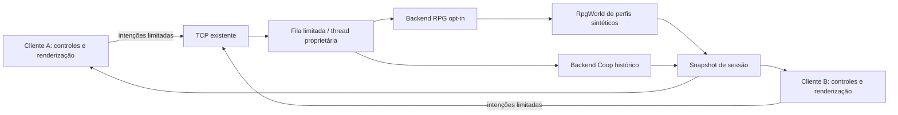

# Arquitetura experimental cliente-servidor

## Auditoria TASK-150

O checkout contém LocalSimulationServer, LocalClient, Protocol, CoopWorld, RemotePresentation e NetworkClientLauncher. Há TCP local, servidor de 30 ticks/s, até duas conexões, handshake V1, snapshots a cada três ticks, filas limitadas, sequenciamento, timeout e teste de dois processos. Não foi necessário restaurar KServer, Kclient, Network, Kryonet ou PostgreSQL.

CoopWorld usa a simulação de arena e habilidades históricas LightningStep/Cryostasis. Não representa as quatro raças e a progressão atuais de RpgWorld. Adaptá-lo silenciosamente mudaria os contratos do Coop. A expansão deve reutilizar transporte/cliente e permitir backend opcional, preservando o construtor padrão e a simulação histórica.

O backend RPG inicial terá uma região estática compartilhada, perfis efêmeros e um RpgWorld por personagem, exclusivamente no servidor. Isso adapta o agregado offline, que possui um único jogador. Não executa duas populações de inimigos paralelas: a cena inicial fica sem NPCs, inimigos, loot ou quests de campanha. Colisões de jogadores usam corpos residentes compartilhados; movimento continua no MovementService/RpgWorld. O cliente não simula posição autoritativa.

Combate compartilhado não será promovido a funcional enquanto não existir contrato de inimigos e eventos comum. A TASK-154 permite movimento somente e combate parcial documentado. Shunpo, técnicas de domínio e habilidades de arena não serão concedidos ao backend RPG iniciante.

O servidor vincula 127.0.0.1 por padrão; LAN exige opção explícita e endereço privado. Não modifica firewall nem roteador. Nomes públicos são rótulos sintéticos, não autenticação. Disconnect remove entidades; reconexão recebe nova sessão e não importa saves offline.

Transporte: thread accept reserva capacidade; reader valida handshake; comando de join entra na fila da thread de mundo; Welcome confirma ID. Owner aplica no máximo 64 comandos por tick e publica snapshot; writer de cada peer conserva somente o estado mais recente. Saída de peer é consumida pela thread proprietária. Falhas encerram sockets e recursos. A taxa de rede não é a duração de frame Walk: apresentação permanece independente.

O protocolo Coop V1 deve continuar interoperável. Extensões cosméticas futuras precisam negociar capacidade por conexão, mantendo clientes V1 sem mensagens novas. Aparência não pode alterar raça, domínio, atributos ou caminhos de arquivo. Persistência online, contas comerciais e segurança de produção ficam fora desta expansão.
