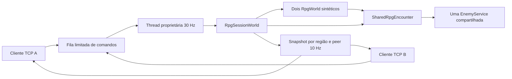

# Corujão V — arquitetura

Checkout `beco`, inicialmente limpo; referência recuperável em `.task-checkpoints/TASK-160/corujao-v/before.zip` e HEAD em `before.json`. Base: TASK-159. O novo pedido autoriza superar o encerramento anterior em 159.

`SessionSimulation` continua sendo a fronteira do transporte. `--combat` habilita o encontro; o construtor anterior conserva o backend de movimento. `RpgWorld` mantém regras raciais, alcance, dano, cooldown, vigor, esquiva, quests e portais. A ligação interna `attachEncounter` exige mundo sintético novo. O construtor cria apenas uma população vazia por personagem antes de receber a referência à população única. O encontro executa IA/respawn uma vez por tick global. A arena usa outro `CombatService`, em `domain/combat`; seu algoritmo não foi transplantado para o RPG.

Ordem: partidas pendentes, até 64 comandos em FIFO, movimento dos jogadores em ordem de sessão, IA compartilhada, snapshots. Intenções não contém dano, posição final ou ID de outro jogador. Eventos têm sequência global e geração de spawn; comandos compartilham sequência entre movimento, aparência e pedidos de mundo. Mutação pertence à thread do servidor; DTOs publicados são cópias imutáveis.

Capacidade experimental: dois jogadores, um slime, duas regiões 960×640, até oito atores no frame, 4096 bytes. Identidades de personagem sintético derivam de UUID aleatório da instância e ID da conexão. A reconexão cria personagem/ledger novo. Desconexão remove o jogador, preservando a população até o término da instância.

Migração incremental: movimento legado → encontro opt-in → aplicação 3 → comandos PvE → metadados por região/quest → validação e pacote separado. `CoopWorld`, saves V1/V2, mapas e protocolos de autoria mantém seus contratos.

Riscos: snapshots consultam `RpgWorld.snapshot()` repetidamente e alocam cópias; o benchmark precisa orientar otimização. A seleção de alvo da IA serve ao encontro de um inimigo, não a populações massivas. O ledger publicado guarda 16 eventos recentes e não oferece entrega durável. Retomada autenticada, mapas grandes e persistência integrada ficam fora desta implementação.
