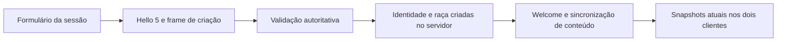

# Spirit Gate — Corujão VII
## Relatório completo de implementação e validação local

Data de fechamento: 31/10/2026 (America/Sao_Paulo).
Escopo: TASK-201 a TASK-212. Projeto-K, Java 17, Swing/Java2D, TCP autoritativo.
Branch: beco. HEAD: 6d72c6595dee6dbe4dea832fe6047ee81f51d4a3.

## 1. Resultado da entrega

As doze tarefas do plano têm implementação integrada nos fontes locais e
validação técnica registrada. Foram gerados dois pacotes privados novos,
Anfitrião e Convidado, versão 0.212.0-private. A distribuição oficial 0.201.0
permaneceu intacta. Não houve commit, push, release ou deploy.

Criação e catálogo de sprites já implementados nas TASKs 201/202 foram
preservados. A autorização posterior do usuário ampliou a execução para todas
as tarefas e exigiu este PDF. As restrições históricas de iniciar apenas uma
tarefa foram superadas; as regras de integridade e autoridade foram mantidas.

A conclusão é técnica e local. Revisão visual humana e homologação entre dois
computadores/Radmin físico permanecem pendentes. Não se declara arte completa,
conta real, persistência online ou teste físico que não foi executado.

## 2. Funcionalidades disponíveis

201 — criação e seleção: nome validado, raça explícita, prévia, acessórios
compatíveis, identidade de sessão independente do nome e reconexão explícita.
Fluxo de janelas conserva o servidor do anfitrião enquanto a partida está viva.

202 — catálogo por raça: Human e Reaper com Idle/Walk em quatro direções,
cadência, escala e pivôs. Aetheri/Spirit usam Human provisório identificado.
Reaper ausente bloqueia entrada e usa fallback geométrico no mundo.

203 — combate visual: início, golpe, impacto, hit, recuperação e derrota
derivados do servidor; efeitos geométricos não causam dano. Idle/Walk continuam
no atlas. Eventos/snapshots repetidos não reaplicam efeitos de gameplay.

204 — HUD: barras reais de HP/energia, dano flutuante, alvo confirmado,
recuperação e estado de derrota; atualização Swing na EDT sem carregar imagens.

205 — IA: cada inimigo seleciona seu alvo vivo da região por distância/ID,
respeita obstáculos, alcance, perseguição, retorno, morte e respawn do motor.

206 — loot: recompensa individual por contribuição para jogadores vivos da
região. Tabela instalada, +3 XP e +5 moedas por mob; ledger por spawn/geração,
política de recompensas desabilitadas e coleta de pendências preservados.

207 — inventário: janela I, itens/quantidades privados, equipar/desequipar,
consumir e recolher pendentes. O servidor valida sequência, posse, slot,
categoria, nível, cooldown e transições. O cliente não altera itens localmente.

208 — progressão: XP, nível, próximo limiar, ataque e defesa publicados pelo
servidor; feedback de ganho e subida de nível. Sem comando de XP arbitrário.

209 — habilidades: hotbar selecionável, ataque racial, poção, Shunpo ofensivo
e defensivo com energia/cooldown reais. Domínio respeita raça, nível 15 e escolha
única; Shunpo exige nível 20. Descrições de técnicas não são novas habilidades.

210 — missão: conversar com a Anciã, aceitar missão individual, contribuir na
morte de slime, acompanhar objetivo, voltar ao NPC e receber uma poção uma vez.

211 — mundo: bosque/clareira leste, lobo adicional, vila/mercado/Nilo, árvores,
caminhos e segunda passagem recíproca. Duas regiões 960x640, documentos World
Studio, arte existente, spawns/portais e navegação verificados.

212 — integração: regressões, prova gráfica com duas janelas, integridade,
dois pacotes privados e smoke com seus runtimes/JARs, documentação e este PDF.

## 3. Arquitetura e compatibilidade

O servidor continua responsável por movimento, colisão, combate, IA, HP,
energia, morte, loot, inventário, XP, domínio, missão e transições. A interface
somente apresenta snapshots e envia intenções limitadas.

V1–V5 conservam seus frames. V6 é uma capacidade opt-in: opcode 17 transporta
hash da revisão, estado de combate e ficha privada; opcode 18 transporta
sequência, operação e chave. Sem caminhos, quantidade, atributos ou ID alheio
enviados pelo cliente. Limite de frame permanece 4096 bytes. Coleções, strings,
enums e slots são limitados. Comandos carregam hash da revisão atual.

LocalClient.character mantém V5. O fluxo Radmin atual usa LocalClient.gameplay.
Servidor antigo recusa com orientação de atualização; não há downgrade oculto.
Reconexão cria nova sessão efêmera. A ficha não é formato de save.

LauncherSession.start conserva o baseline histórico. startExpanded é usado no
novo fluxo e só cria o mundo novo se não existir revisão publicada. Publicações
existentes não são sobrescritas. A regra histórica impede clientes sem suporte
de conteúdo de entrar numa revisão nova que não conseguem sincronizar.

O código reutiliza InventoryService, LootService, RpgProgression,
DomainProgression, QuestService, AuthoredQuestSession, EnemyService, LiveRevision
e World Studio. Não foram criados novos bancos, autenticação ou contas reais.

## 4. Validação final comprovada

Java completo: 252 fontes e 221 arquivos de testes compilados; 689 executados,
668 aprovados em headless, 21 abortados por exigir GUI, zero falhas/skips.
Complemento Swing: 29 execuções aprovadas, cobrindo os 21 abortos e repetindo
oito casos. Não somar repetições como novos testes únicos.

Python: 97 testes aprovados, processo final com código 0.
Atualizador PowerShell: 39 verificações aprovadas.
Transporte GitHub PowerShell: 21 verificações aprovadas, HTTPS simulado.
Nenhuma publicação ou download de produção foi necessário.

Provas TCP reais locais: criação/reconexão; raças Human/Reaper; dano/HP; loot;
inventário privado; XP único; Shunpo e domínio; missão inteira; portais; revisão,
rollback, admissão histórica e segurança. Mocks complementam, não substituem,
essas provas. O teste adicional V6 cobre replay de equipamento/poção e transição.

Prova gráfica: duas janelas reais com conteúdo/raças, hotbar, diário e barras;
abertura do inventário. Capturas foram inspecionadas. Os mapas foram renderizados
com contornos de colisão e passaram no validador nativo, sem diagnósticos,
com zero amostras isoladas na análise de navegação.

Pacotes: manifests conferidos por tamanho e SHA-256, 391 arquivos por papel.
Smoke em três processos usando runtime/bin/java.exe e o JAR dos pacotes:
servidor, cliente Reaper e cliente Human; todos saíram 0. Clientes recebem
duas aparências e ficha V6. Convidado impedido de hospedar. Não foi executado
separadamente o EXE nativo nem um teste físico em duas máquinas.

## 5. Falhas encontradas e correções

O teste 203 encontrou hit residual após respawn; o estado foi limpo.
Compilações intermediárias dos testes 208/209/210 encontraram sobrecarga com
null e variáveis capturadas não finais; corrigidas antes das provas finais.

A primeira suite completa encontrou 11 falhas após trocar o baseline da
fábrica histórica. O coordenador classificava corretamente a expansão como
revisão nova e recusava peers antigos. Separar start/startExpanded preservou
o contrato histórico. Admissão, publicação, rollback e segurança foram repetidos
com sucesso; a suite inteira final passou. Nenhum teste foi desativado.

O primeiro comando Python via shell registrou “97 OK”, mas o PowerShell tratou
stderr de um teste negativo como falha de shell. Captura subprocess unificada
confirmou processo 0. O smoke inicial usou nome de JAR não normalizado no probe;
ajustado para app/spirit-gate-rpg.jar, o smoke final aprovou os dois pacotes.

O primeiro diagnóstico da skill de mapas apontou stdout cp1252; reexecutado
com PYTHONUTF8=1. Permanecem avisos de múltiplos Python e ferramentas opcionais
de mídia ausentes (ffmpeg/resvg/APIs/Grok). Não foram necessárias para reutilizar
arte instalada e os resultados originais foram preservados no checkpoint.

## 6. Preservação e rastreabilidade

Baseline: 2805 arquivos; 12 fontes existentes alteradas; nenhum ausente.
2320 arquivos de assets/saves/distribuição protegidos sem alteração.
19 arquivos novos em server/src: oito fontes e onze testes.

Fontes permaneceram estáveis durante os testes finais. A árvore Git já tinha
mudanças e exclusões anteriores: não houve reset, clean ou restauração dessas
exclusões. Três capturas históricas regeneradas pela suite foram movidas para
evidências, mantendo a limpeza anterior. Assets originais não foram regravados.

Checkpoint inicial: .task-checkpoints/CORUJAO-VII-REMAINING/.
Checkpoints por etapa: TASK-203 a TASK-212/corujao-vii/.
Complementos: TASK-212-GUI e TASK-212-INTEGRITY.
Patch incremental e lista de novos arquivos no checkpoint TASK-212.

Fontes existentes modificadas nesta autorização:
- server/src/main/java/com/projetok/multiplayer/LocalClient.java
- server/src/main/java/com/projetok/multiplayer/LocalSimulationServer.java
- server/src/main/java/com/projetok/multiplayer/Protocol.java
- server/src/main/java/com/projetok/multiplayer/RpgNetworkClientLauncher.java
- server/src/main/java/com/projetok/multiplayer/RpgSessionWorld.java
- server/src/main/java/com/projetok/multiplayer/SessionSimulation.java
- server/src/main/java/com/projetok/rpg/EnemyService.java
- server/src/main/java/com/projetok/rpg/RpgWorld.java
- server/src/main/java/com/projetok/rpg/SharedRpgEncounter.java
- server/src/main/java/com/projetok/studio/StudioMapRenderer.java
- server/src/main/java/com/projetok/prototype/rpg/LauncherSession.java
- server/src/main/java/com/projetok/prototype/rpg/RadminSessionPanel.java

Novos arquivos de fonte/teste:
- server/src/test/java/com/projetok/multiplayer/Task203CombatPresentationTest.java
- server/src/test/java/com/projetok/multiplayer/Task204CombatHudTest.java
- server/src/test/java/com/projetok/multiplayer/Task207InventoryTest.java
- server/src/test/java/com/projetok/multiplayer/Task208ProgressionTest.java
- server/src/test/java/com/projetok/multiplayer/Task209AbilitiesTest.java
- server/src/test/java/com/projetok/multiplayer/Task210QuestJourneyTest.java
- server/src/test/java/com/projetok/multiplayer/Task211WorldExpansionTest.java
- server/src/test/java/com/projetok/multiplayer/Task212GameplayIntegrityTest.java
- server/src/test/java/com/projetok/multiplayer/Task212PlayableUiTest.java
- server/src/test/java/com/projetok/rpg/Task205EnemyTargetsTest.java
- server/src/test/java/com/projetok/rpg/Task206SharedLootTest.java
- server/src/main/java/com/projetok/multiplayer/GameplayProtocol.java
- server/src/main/java/com/projetok/multiplayer/NetworkCombatHud.java
- server/src/main/java/com/projetok/multiplayer/NetworkCombatPresentation.java
- server/src/main/java/com/projetok/multiplayer/NetworkHotbar.java
- server/src/main/java/com/projetok/multiplayer/NetworkInventoryPanel.java
- server/src/main/java/com/projetok/multiplayer/NetworkProgressLabel.java
- server/src/main/java/com/projetok/multiplayer/NetworkQuestPanel.java
- server/src/main/java/com/projetok/studio/CorujaoSevenWorld.java

Ferramentas adicionadas: corujao7_verify.py, CorujaoSevenPackageProbe.java,
smoke_corujao7_package.py e gerar_relatorio_corujao7.py. Documentação: três
arquivos por tarefa, plano, progresso, pendências, continuidade e consolidado.

## 7. Pacotes e como executar

Diretório: dist/SpiritGate-CorujaoVII-0.212.0-private/.
Extraia o ZIP do papel em uma pasta nova. Abra SpiritGate-Launcher.exe na raiz
do pacote. Anfitrião hospeda; convidado usa o endereço Radmin do anfitrião.
Feed remoto desativado: os pacotes não anunciam atualização oficial publicada.
Mantenha o oficial anterior em sua pasta. Não copie saves para versions.

Controles: WASD mover; SPACE atacar; I inventário; 1 usar ação selecionada;
SHIFT Shunpo ofensivo; Q defensivo; F conversar; E aceitar missão; C entregar;
P portal próximo; R retornar após morte; F2 diagnóstico. Use as opções de zoom.
O nível inicial normal é 1; os testes de habilidade usaram nível 20 no fixture
do servidor, sem oferecer comando de XP ao jogador.

Para executar os fontes: rodar-prototipo.cmd e opções Radmin do Portal.
Jogos offline e Coop conservam seus caminhos anteriores.

Hashes da entrega:

Manifest comum: 1d39878477eb1f2574469a262f2be494de954680ca2037a949812986492a619e

anfitriao: SpiritGate-Atualizavel-0.212.0-private-Windows64.zip
SHA-256: 555137478312b13b0d86c637310727cae455438e470205d4c00fb2707df6ac36

convidado: SpiritGate-Atualizavel-0.212.0-private-Convidado-Windows64.zip
SHA-256: d3b77f702488d35d6c75bd16430ba7f77b19084e354c88f49d2fa2ea99bc6ebd

## 8. Gates e limites finais

Gate A: criação, raça e renderização verificados localmente.
Gate B: combate, HUD e IA integrados à autoridade do servidor.
Gate C: loot, inventário, progressão e habilidades com proteção contra replay.
Gate D: uma missão instalada e exploração/portais das duas regiões verificados.
Gate E: regressões, pacotes privados, evidências, documentação e PDF entregues.

Os gates acima representam validação técnica local. Não substituem aceite
artístico, legibilidade em todos os monitores ou homologação física Radmin.

Limites: Aetheri/Spirit sem atlas próprio; Reaper sem acessórios novos;
Run/Attack/Hit/Death sem quadros próprios; técnicas de domínio ainda descritivas;
uma missão instalada; duas regiões; IA usa colisão/movimento existentes, sem A*;
inventário de 20 slots e pendências finitas do motor; sem comércio online novo.
No teto técnico de pendências, novas recompensas podem ser recusadas pelo
LootService; itens anteriores são preservados. Sem economia global persistente.

Personagem, inventário, XP e missão pertencem à sessão experimental. Desconexão
e reconexão não salvam esse progresso como conta online. Não houve migração
de saves pessoais, contas públicas, TLS ou banco externo.

Próxima ação do responsável: revisar as capturas/experiência e organizar a
prova em dois computadores. Bugs vistos nessa homologação devem gerar evidência
nova, sem reclassificar os testes locais como teste físico.

## 9. Índice das evidências principais

TASK-212/corujao-vii/java-full-final.log — suite Java inteira.
TASK-212-GUI/corujao-vii/verification-gui.json — nove classes Swing.
TASK-212/corujao-vii/python-tests-clean.log — 97 testes Python.
TASK-212/corujao-vii/updater/results.json — 39 verificações.
TASK-212/corujao-vii/github-transport/results.json — 21 verificações.
TASK-212/corujao-vii/package-build/build-evidence.json — build e origem.
TASK-212/corujao-vii/package-smoke-final/result.json — processos empacotados.
TASK-212/corujao-vii/preservation-final.json — integridade e fontes estáveis.
TASK-212/corujao-vii/corujao7-source.patch — mudança contra o início desta rodada.
TASK-211/corujao-vii/*.sgmap e *-navigation.png — documentos e colisões.
TASK-212/corujao-vii/ui/*.png — duas janelas e inventário.

## 10. Apêndices por tarefa

Os documentos das TASKs 201/202 preservam suas datas, decisões e números
históricos. As frases “próxima tarefa não iniciada” nesses registros descrevem
aquele encerramento, não o estado final deste PDF. O resultado consolidado
atual é o das seções anteriores. Não somar rodadas repetidas como testes únicos.

# Apêndice — TASK-201.md

# TASK-201 — criação de personagem multiplayer e fluxo de janelas

Auditoria e aprovação: 27/10/2026. Fechamento local: 28/10/2026.
**Implementada e validada localmente, com fontes congeladas.**
A aprovação incluiu a aplicação negociada 5, o frame de criação, o fallback
Human identificado para Aetheri/Spirit e a redução das janelas de entrada.
A TASK-202 não foi iniciada. O [plano original](CORUJAO-VII-PLANO.md) permanece
preservado, com adendo de execução.

## Baseline conferido

- Branch `beco`; HEAD `6d72c6595dee6dbe4dea832fe6047ee81f51d4a3`.
- Distribuição presente: `dist/SpiritGate-GitHub-0.201.0`; canal GitHub.
- Antes desta tarefa: 26 arquivos modificados, 2.432 exclusões e 40 entradas
  não rastreadas no status resumido. Incluem a limpeza autorizada, correções
  anteriores de rede, colisão e sprites e as ferramentas novas do launcher.
- Fontes, assets e comandos protegidos por SHA-256: 1.242 arquivos.
  Oito arquivos pessoais em saves/projetos também foram conferidos sem mudanças.
- Checkpoint: `.task-checkpoints/TASK-201/corujao-vii/`, com estado Git,
  diff anterior, snapshot de fontes e resultados novos da auditoria.
- O Corujão VI foi informado como aceito pelo responsável. Os documentos
  antigos ainda registram ressalvas locais; o aceite informado não é convertido
  em nova execução Radmin entre computadores.

## 1. Arquitetura encontrada na auditoria — baseline histórico

Esta seção descreve o estado anterior à implementação. A atribuição por
assento continua apenas no ingresso legado V1–V4; o caminho novo usa a
escolha confirmada pelo jogador.

Na auditoria, o caminho dos pacotes passava por `SpiritGateEntry` e
`RadminSessionPanel`. O anfitrião iniciava o servidor e entrava como jogador em
ações separadas; o Convidado conservava a restrição de hospedagem. A conexão
usava `LocalClient.revision`, aplicação 4 com sincronização de conteúdo.

| Fonte inspecionada | Resultado |
|---|---|
| `prototype/rpg/SpiritGateEntry.java:33–38` | Entradas Hospedar/Entrar abrem `RadminSessionPanel`. |
| `prototype/rpg/RadminSessionPanel.java:16,34,59` | Campos de conexão e nome; conecta em V4 e abre a janela de jogo. Não escolhe raça. |
| `prototype/rpg/LauncherSession.java:19` | Cria `RpgSessionWorld` com a lista `reaper,human`. |
| `multiplayer/RpgSessionWorld.java:29,61–74` | O assento disponível determina a raça. Assento 0 recebe Reaper; assento 1 recebe Human. |
| `multiplayer/LocalSimulationServer.java:10,36,53–65` | IDs atribuídos pelo servidor; admissão e comandos encaminhados à thread proprietária da simulação. |
| `multiplayer/RpgSessionWorld.java:17,73,129` | UUID efêmero derivado de instância aleatória do mundo + ID; não depende do nome. |
| `multiplayer/LocalClient.java:64` | Reconexão conserva nome/transporte, mas cria outra sessão. Ainda não existe escolha de raça para conservar. |
| `rpg/CharacterRaces.java:10–21` | Já reconhece Reaper, Human, Aetheri e Spirit e suas regras iniciais. |
| `multiplayer/NetworkPlayerVisuals.java:10–23` | Resolve atlas Reaper ou Human; raças sem atlas próprio recebem o corpo Human. |

Os caminhos da tabela partem de `server/src/main/java/com/projetok/`.
O registro de raças aplicável à criação RPG é `rpg.CharacterRaces`.
`domain.race.RaceRegistry` é outro catálogo genérico de entidades, usado também
pelo Coop histórico; não precisa ser reconstruído para esta tarefa.

A atribuição fixa foi confirmada no código e no contrato de testes:
`RpgSessionServerTest.java:15`, `NetworkCosmeticsTest.java:17` e
`FinalNetworkIsolationTest.java:16` esperam o comportamento histórico.

### Fluxo offline existente

`CharacterCreation.java:40–46,99–115` já oferece quatro raças, validação,
confirmação e cancelamento. Porém, o callback em `RpgMenu.java:26,42` cria
`RpgWorld` e grava `LocalSaveStore`. `RpgLauncher` conduz esse mundo offline.
Não se deve chamar esse fluxo para criar uma sessão multiplayer.

`CharacterIdentity.java:12–16` normaliza e valida o nome. O componente
histórico `archetype` já representa uma raça, com alias `race()`; seu formato
de save será preservado. A aparência offline `azure/amber` não equivale aos
cosméticos de rede e não recolore os PNGs atuais.

### Assets necessários à TASK-201

Esta é a verificação mínima para a prévia; não inicia o catálogo completo
de ações/animações previsto para a TASK-202.

| Raça | Arquivos reais disponíveis | Comportamento visual atual |
|---|---|---|
| Reaper | 36 PNGs 64×64: 4 Idle e 32 Walk, quatro direções | Escala nativa 1×, pivô `(32,60)`, 125 ms/quadro. |
| Human | 20 PNGs: 4 Idle e 16 Walk, quatro direções | Normalização 0,4× para canvas lógico 64×64; 250 ms/quadro. |
| Aetheri | Nenhum atlas dedicado localizado | Corpo Human provisório. |
| Spirit | Nenhum atlas dedicado localizado | Corpo Human provisório. |

Fontes: `rpg/reaper-player.properties`, `rpg/experimental-player.properties`
em resources, `RpgPlayerSprites.java:66–98` e `NetworkPlayerVisuals`.
O catálogo temporário contém três cabelos e três roupas, com 180 camadas/poses.
Ele é vinculado ao corpo Human (`CosmeticCatalog.java:32–36`). O renderer
desliga esses acessórios para Reaper (`RpgNetworkClientLauncher.java:51`).

## 2. Lacunas identificadas na auditoria

1. Falta um formulário de personagem de sessão antes da conexão, com raça e prévia.
2. A raça precisa alimentar a identidade e as regras no servidor, e não somente a imagem.
3. `Hello` leva apenas versão de aplicação e nome; `AppearanceRequest` só cabelo/roupa.
4. A reconexão ainda não possui uma escolha explícita para transportar.
5. A interface não informa o fallback Human de Aetheri/Spirit nem a ausência
   de acessórios compatíveis com Reaper.

## 3. Arquitetura aprovada e implementada

### Formulário e modelo de sessão

Foram criados o painel `SessionCharacterCreation` e o modelo imutável
`SessionCharacterSelection`, com nome, raça, cabelo e roupa. O painel é
embutido na conexão modal Radmin, sem janela adicional própria. Reutiliza
`CharacterRaces`, estilo visual e validação, sem chamar a seleção de slots
offline, `LocalSaveStore` ou contas online.

- Nome com as regras atuais, normalizado antes do envio.
- Quatro raças e prévia baseada na mesma resolução visual usada no mundo.
- Aetheri/Spirit: aviso **“aparência Human provisória; sem atlas próprio”**.
- Reaper: acessórios `none`, com aviso de ausência de recursos compatíveis.
- Human e fallbacks compatíveis: escolhas somente do catálogo instalado.
- Aetheri/Spirit usam o raster Human existente, com aviso explícito.
- Atlas necessário ausente ou recusado pelo carregador: aviso e confirmação
  bloqueada, sem apresentar recursos indisponíveis como concluídos.
- Recursos carregados fora do EDT; mudança de seleção redesenha recursos em memória.
- Confirmar uma vez para conectar; sair da escolha antes dessa confirmação
  não abre conexão nem grava save. Se o worker terminar enquanto o anfitrião
  decide cancelar, o resultado aguarda a decisão; cancelar libera os recursos
  e recusar o cancelamento permite concluir a entrada.

A seleção vale para a conexão experimental atual. Não cria uma coleção de
personagens persistentes, nem recupera personagem de outro jogador pelo nome.
Nomes iguais continuam permitidos conforme o comportamento atual; IDs e
UUIDs gerados pelo servidor isolam as identidades.

### Extensão negociada de aplicação

O envelope binário atual é **V1**, inclusive quando `Hello.version` vale
2, 3 ou 4. Estes números negociam capacidades da aplicação.
`Protocol.read` recusa bytes excedentes (`Protocol.java:95`), portanto
acrescentar campos ao Hello antigo quebraria seus leitores.

Foi implementada a **aplicação 5**, herdando os recursos da aplicação 4 e
acrescentando criação explícita de personagem. O Hello e os opcodes 1–15
conservam seus bytes. O novo frame `CharacterCreate`, opcode 16, leva
raça/cabelo/roupa depois de `Hello(5,nome)` e antes de `Welcome`/entrada
no mundo.

O servidor valida o perfil e admite o jogador de uma vez na thread da
simulação. O cliente não define ID, UUID, atributos, spawn, itens ou domínio.
A implementação reutiliza `CharacterIdentity`, `RpgWorld` e snapshots de aparência existentes.
O assento continua definindo posição/capacidade; deixa de definir a raça no
caminho novo. A criação não é aceita como comando para trocar raça no
meio de uma sessão já admitida.

A reconexão mantém a escolha no cliente e cria uma nova identidade efêmera
no servidor, preservando a semântica atual de “reconectar nova sessão”.

### Compatibilidade e publicação de mapas

| Combinação | Comportamento implementado |
|---|---|
| Cliente V1–V4 → servidor novo | Frames e ingresso históricos preservados, incluindo raça por assento no caminho legado. |
| Cliente novo → servidor novo | Escolha explícita validada antes da admissão. |
| Cliente novo → servidor antigo | Erro claro pedindo atualização, sem ignorar silenciosamente a raça escolhida. |
| Coop/servidor sem capacidade nova | Não anunciar suporte à seleção que não consegue cumprir. |
| Publicação com peer legado | Preservar bloqueios existentes; não promover V1–V3 a clientes de conteúdo. |

Compatibilidade conserva os recursos que cada aplicação já conhecia. Um
cliente V1 sem aparência negociada não passa a renderizar novas raças;
as provas da seleção completa usaram dois clientes novos.

Na auditoria, `RevisionCoordinator.java:60,79,81,92` comparava literalmente aplicação 4.
Os gates passaram a reconhecer a nova capacidade negociada, conservando
barreiras, ACKs, rollback e recusa de peers antigos após conteúdo incompatível.
O schema de `WorldContent` e sua tag histórica foram preservados, pois
o conteúdo dos mapas não foi alterado por esta tarefa.

Regras novas de combinação raça/cosmético ficam no caminho negociado novo;
não modificar globalmente os pedidos legados sem necessidade.

## 4. Arquivos da implementação

Produção, partindo de `server/src/main/java/com/projetok/`:

| Arquivo | Alteração realizada |
|---|---|
| `multiplayer/SessionCharacterSelection.java` | Perfil efêmero validado, sem identificador escolhido pelo cliente. |
| `prototype/rpg/SessionCharacterCreation.java` | Painel, prévia e limitações; confirmação/cancelamento pertencem ao modal Radmin. |
| `prototype/rpg/RadminSessionPanel.java` | Confirmar escolha antes da conexão, preservando hospedar/entrar separados. |
| `multiplayer/Protocol.java` | Aplicação opt-in e frame novo; bytes antigos preservados. |
| `multiplayer/SessionSimulation.java` | Capacidade e ingresso explícito, mantendo métodos legados. |
| `multiplayer/LocalSimulationServer.java` | Fase de criação validada antes da admissão/Welcome. |
| `multiplayer/LocalClient.java` | Handshake escolhido e perfil mantido para reconexão. |
| `multiplayer/RpgSessionWorld.java` | Criar mundo com a raça aceita; validar cosméticos no caminho novo. |
| `multiplayer/RevisionCoordinator.java` | Reconhecer aplicação nova nos gates de conteúdo. |
| `multiplayer/NetworkPlayerVisuals.java` | Expor à prévia a resolução/fallback já existente. |
| `multiplayer/RpgNetworkClientLauncher.java` | Perfil na reconexão, apresentação recebida do worker e cosméticos compatíveis. |
| `prototype/rpg/SpiritGateEntry.java` e `RpgMenu.java` | Marcar telas de navegação e identificar o dono da conexão modal. |
| Novos `prototype/rpg/SessionWindowNavigation.java` e `SessionGameLifecycle.java` | Fechar a navegação ao entrar; transferir o servidor à partida e conservar sua posse na reconexão. |

`RpgLauncher`, saves pessoais, schemas e persistência sintética permanecem
fronteiras de regressão. A mudança em `RpgMenu` se limita à navegação.
Os assets originais não foram editados. O escopo adicional aprovado alterou
`tools/updater/Launcher-SpiritGate.ps1` e `Atualizar-SpiritGate.ps1` para
transferir a execução ao processo do jogo e fechar o launcher após a confirmação
de abertura. Os testes correspondentes estão em [TASK-201-TESTES.md](TASK-201-TESTES.md).

## 5. Riscos e controles

- **Compatibilidade:** não ampliar frames antigos nem fazer downgrade silencioso.
- **Admissão incompleta:** limitar leitura/tempo/fila e liberar capacidade em erro,
  perfil ausente, duplicado, inválido ou desconexão.
- **Autoridade:** validar o perfil no servidor e recusar criação fora de fase.
- **Conteúdo:** testar ingresso, publish, rollback e reconexão em mistura V4/nova aplicação.
- **Identidade:** manter IDs/UUIDs da sessão, sem transformar nome em chave de conta.
- **Offline:** formulário separado; nenhuma escrita em saves ou integração sintética.
- **Arte:** fallback identificado; Reaper preservado; sem novas imagens ou ajuste de hitbox.
- **EDT:** sem sockets ou carregamento de imagens no evento de renderização.

## 6. Validação

O baseline, a matriz executada e as evidências estão em
[TASK-201-TESTES.md](TASK-201-TESTES.md). A implementação foi verificada com:

1. Formulário real, quatro raças, confirmação/cancelamento, nomes válidos e inválidos.
2. Round-trip/limites do frame novo e golden bytes V1–V4 preservados.
3. Servidor TCP real e dois clientes: Reaper/Human, ordem invertida e duas raças iguais.
4. Identidades distintas para nomes iguais; reconexão mantém escolha e recebe novo UUID.
5. Perfis inválidos e fora de fase não criam personagem nem alteram o outro jogador.
6. Dois renderizadores mostrando os perfis autoritativos, com capturas da tela nova e do mundo.
7. Conteúdo, publicação/rollback, colisão, combate, offline/saves e launcher sem regressões.
8. Conclusão do worker durante cancelamento Radmin, reconexão durante confirmação
   de encerramento e falha de rede depois de fechar a janela, sem ingresso ou modal tardio.
9. Falha ao gravar a confirmação WinForms encerra somente o processo recém-criado
   e aguarda a saída antes de liberar o lock; processos anteriores são preservados.

A rodada final compilou 243 fontes e 209 arquivos de testes Java: 671 casos
executados, 651 aprovados em headless, 20 abortados por exigir GUI e nenhuma
falha ou skip. O complemento Swing aprovou 28 execuções, cobrindo os 20 abortos
e repetindo oito casos já aprovados. Python aprovou 97 testes; as regressões
PowerShell aprovaram 39 verificações do atualizador e 21 do transporte GitHub.
As fontes permaneceram estáveis durante a rodada final.

## 7. Aprovação e fluxo de janelas

Depois da auditoria, o usuário aprovou expressamente a implementação da
TASK-201 e acrescentou o ajuste do fluxo de janelas. A proposta de aplicação
opt-in 5 e frame de criação deixou de ser uma decisão pendente.

O fluxo implementado é:

1. O launcher verifica a instalação e inicia o processo do jogo. Fecha sua
   interface após receber a confirmação de um processo ainda vivo.
2. A conexão Radmin abre como `JDialog` modal, pertencente à tela de entrada.
   O formulário de personagem fica dentro desse modal.
3. Depois da entrada efetiva, o modal e as telas de navegação identificadas
   são descartados. Editores e outras partidas não são fechados por essa ação.
4. O servidor iniciado pelo anfitrião passa a ser propriedade da partida.
   Ele continua vivo ao fechar a navegação e ao substituir a janela durante
   uma reconexão. O encerramento confirmado da janela final encerra o servidor.
5. A prévia, o mundo e a reconexão reutilizam a mesma apresentação carregada
   pelo worker, evitando resolver outro atlas a partir do diretório de execução.

A confirmação do launcher atesta processo vivo após a checagem inicial;
não significa que o mundo ou a conexão TCP já terminaram de carregar.
Falhas imediatas de abertura mantêm a interface do launcher recuperável.
A confirmação de cancelamento Radmin já é coordenada com a conclusão do
worker. Na partida, uma reconexão que termina durante a confirmação de
encerramento é descartada, liberando sua conexão; recusar o fechamento
mantém o anfitrião e permite tentar novamente. Aceitar encerra a partida
sem outra janela substituir a decisão. Erros tardios não reabrem modais
depois de a janela ter sido descartada.

Se a gravação do ACK falhar após iniciar Java, o engine encerra somente o
processo recém-criado e aguarda a saída antes de liberar o lock. Se não
conseguir encerrá-lo imediatamente, conserva a supervisão até confirmar a
saída. Os testes dessas situações e da apresentação compartilhada estão
registrados em [TASK-201-TESTES.md](TASK-201-TESTES.md).

A revisão contra o checkpoint anterior está em
`implementation/task201-source.patch` e `implementation/source-changes.json`,
sob `.task-checkpoints/TASK-201/corujao-vii/`. São 26 arquivos de código/testes:
14 existentes alterados e 12 novos, preservando as mudanças anteriores.

## 8. Disponibilidade e próximo passo

As mudanças estão nos fontes locais e nas evidências desta TASK. A distribuição
pública `dist/SpiritGate-GitHub-0.201.0` permanece imutável, com seus executáveis
e scripts já publicados. Ela não recebeu a seleção nova nem o novo fluxo de
janelas apenas por esses fontes terem sido alterados. Nenhuma atualização
pública foi anunciada ou enviada, e nenhum pacote novo foi gerado nesta tarefa.

Para testar os fontes atuais, execute `rodar-prototipo.cmd` e use as opções
Radmin no Portal de entrada. `jogar-rpg-offline.cmd` é um alias desse caminho.
Esse teste executa o código Java novo; o EXE da distribuição 0.201.0 continua
executando sua entrega anterior. A mudança WinForms será distribuída somente
quando um pacote posterior for preparado e autorizado para publicação.

A validação desta tarefa usa servidor e clientes TCP reais no mesmo computador.
Não houve teste novo em dois computadores ou Radmin físico, nem aprovação
artística humana das capturas. Aetheri/Spirit continuam com aparência Human
provisória; Reaper não ganhou acessórios nem imagens novas.

A TASK-202 continua não iniciada. O Gate A depende também dela; esta entrega
não fecha o Corujão VII. O próximo passo é revisão do responsável e uma nova
instrução para avançar, preservando o escopo e as restrições do plano.

# Apêndice — TASK-201-TESTES.md

# TASK-201 — testes e evidências

Auditoria e aprovação: 27/10/2026. Fechamento local: 28/10/2026.
A implementação aprovada inclui aplicação 5, fallbacks e redução das janelas
de entrada. A rodada final passou com as fontes congeladas, incluindo
cancelamento durante conexão, reconexão durante encerramento, erro de rede
tardio e recuperação da falha de gravação do ACK após iniciar Java.

## Baseline histórico da auditoria

Estes resultados precedem a implementação e permanecem como referência:

| Verificação | Resultado |
|---|---|
| `python tools/run-local-tests.py` | 239 fontes e 203 arquivos de testes; 641 executados, 631 aprovados, 10 abortados por GUI, 0 falhas e 0 skips. |
| Complemento gráfico do baseline | 17 aprovados; cobre os 10 abortados e repete sete casos. |
| Suite Python do baseline | 94 aprovados. |
| Preservação na auditoria | 1.242 arquivos de fonte/assets/comandos e oito arquivos pessoais conferidos, sem divergências naquela etapa. |

O relatório `docs/TASK-035-estresse.json`, já modificado antes da auditoria,
foi protegido e restaurado para seus bytes anteriores quando necessário.
As capturas regeneradas ficaram no checkpoint 201, preservando as exclusões
autorizadas na limpeza anterior.

## Execuções da implementação registradas

| Verificação | Resultado e evidência |
|---|---|
| Suite Java completa final | 243 fontes e 209 arquivos de testes; **671 executados, 651 aprovados, 20 abortados por GUI, 0 falhas e 0 skips**. `implementation/java-headless.log` e `java-headless.json`; hashes estáveis durante a execução. |
| Complemento gráfico consolidado | Oito classes, **28 executados e aprovados**, 0 abortos/falhas/skips. Cobre os 20 abortos headless e repete oito casos já aprovados. `implementation/java-graphical-consolidated.json`. |
| Suite Python completa final | **97 aprovados**, incluindo os três testes do handoff. `implementation/python-final.json`. |
| Handoff após a correção do ACK | **3 testes aprovados**, já incluídos nos 97 Python. `launcher-handoff/verification.json`. |
| Atualizador PowerShell após a correção do ACK | **39 verificações aprovadas**. `launcher-handoff/updater-regression/results.json` e `verification.json`. |
| Transporte GitHub PowerShell após a correção do ACK | **21 verificações aprovadas**, com transporte HTTPS simulado; não são novos downloads de produção. `launcher-handoff/github-regression/results.json` e `verification.json`. |
| Compilação de entrada | `tools/compile-local.ps1`: 243 fontes Java compiladas. |

O consolidado gráfico contém fluxo de janelas 1, Radmin 1, cancelamento Radmin 7,
reconexão/encerramento 3, gestos do Studio 1, quests 1, lifecycle TASK-191 7 e
usabilidade do Studio 7. As oito repetições são os sete casos de usabilidade e
um caso do formatador do painel, já aprovados em headless. Os 20 abortos foram
conferidos por classe contra o log completo e cobertos nesse consolidado.

As rodadas intermediárias de 18 gráficos e dos seis focados após compartilhar
a apresentação permanecem nas evidências; o fechamento usa a rodada consolidada.

Não somar execuções gráficas repetidas como testes únicos adicionais.
O aborto headless significa que a janela exige ambiente gráfico; não é
apresentado como aprovação visual. As execuções gráficas usam Swing real.

## Matriz executada

| Área | Casos e resultado |
|---|---|
| Modelo e formulário | Nome normalizado, quatro raças, recuperação da escolha, prévia por atlas e dimensões de painel. Dados inválidos são recusados. |
| Aparência | Reaper sem acessórios incompatíveis; Aetheri/Spirit identificados como Human provisório; atlas obrigatório ausente impede confirmar. |
| Protocolo | Round-trip do opcode 16, bytes históricos V1–V4, rejeição de truncamento e campos excedentes. |
| TCP e identidade | Servidor e dois clientes reais; quatro raças iguais com nomes iguais e IDs distintos; Human antes de Reaper; reconexão com nova sessão e escolha preservada. |
| Admissão negativa | Perfil inválido/ausente não cria ator; acessórios Reaper indevidos e segunda criação não alteram outro jogador. Servidor sem capacidade retorna orientação de atualização. |
| Conteúdo | Cliente selecionado e V4 publicam/retornam revisão mantendo a raça; peer V1 continua bloqueando publicação incompatível. |
| Janelas Java | Modal de seleção, descarte da navegação após entrada e preservação do anfitrião na troca de janela/reconexão; encerramento da janela final fecha o servidor. Resultados de conexão aguardam a decisão de cancelamento; reconexão não substitui a janela sob confirmação de encerramento. |
| Renderer | O jogo recebe `Presentation` com os atlas/camadas do worker. A prova gráfica verifica `usesReaper("reaper")` e captura os corpos Human/Reaper. |
| Handoff WinForms | Processo filho continua após a UI sair; papel, argumentos, diretório e lock conservados. Executável inválido/saída imediata mantêm o formulário recuperável; confirmação fora da instalação é recusada. Falha ao gravar ACK encerra somente o filho novo e espera a saída antes de liberar o lock, inclusive quando a tentativa de encerramento é negada. |
| Offline e dados pessoais | O formulário não cria janelas próprias, não usa saves offline e não grava dados pessoais. As regressões offline, Coop e persistência permanecem na suite geral. |

O ACK do handoff confirma processo vivo após a checagem inicial de 350 ms.
Não confirma que a conexão TCP ou o carregamento do mundo já acabaram.
O teste WinForms usa um helper local limitado; não apresenta esse helper
como uma sessão de jogo em dois computadores.

## Correções verificadas no fechamento

1. **Apresentação compartilhada:** prévia, jogo e reconexão recebem os mesmos
   atlas/camadas carregados no worker. A prova de fluxo usa os corpos reais
   Human/Reaper e verifica o atlas Reaper explicitamente.
2. **Cancelamento Radmin:** sete casos, sendo seis gráficos e um de formatação,
   verificam resultados de conexão durante a decisão, confirmação aceita ou
   recusada e descarte dos recursos. Evidência em `implementation/review-cancel/`.
3. **Reconexão durante encerramento:** três testes com `LauncherSession` e
   `LocalClient` reais. Uma ponte TCP local somente retarda ou corta bytes;
   não fabrica mensagens. Os três reproduziram falhas antes da correção e
   passaram depois: confirmação aceita, recusada com nova tentativa bem-sucedida
   e falha de rede após fechar o host, sem popup tardio. Evidência em
   `lifecycle-reconnect/`, com capturas e resultados por execução.
4. **Falha de gravação do ACK:** injeção determinística após iniciar o helper
   comprova que somente o filho novo é encerrado, que o processo anterior
   sobrevive e que o lock permanece até a saída. O caso complementar de
   encerramento negado mantém a supervisão. Evidência em `launcher-handoff/`.

## Classes novas e regressões

- `multiplayer/SessionCharacterSelectionTest`: modelo, frames e autoridade.
- `multiplayer/Task201CharacterSessionTest`: sessões TCP reais e compatibilidade.
- `prototype/rpg/SessionCharacterCreationTest`: quatro casos de formulário,
  recursos, paint e ausência de escrita em saves.
- `prototype/rpg/Task201SessionWindowFlowTest`: fluxo gráfico integrado,
  dois clientes reais e apresentação compartilhada na reconexão.
- `prototype/rpg/Task201RadminCancellationTest`: seis casos gráficos de
  cancelamento concorrente e um caso de formatação do painel.
- `prototype/rpg/SessionGameReconnectCloseTest`: três cenários gráficos de
  reconexão/encerramento, com servidor TCP real.
- `tools/test_launcher_handoff.py` e `updater/Test-Launcher-Handoff.ps1`:
  passagem da UI WinForms para processo independente.

Continuam aplicáveis as regressões de protocolo, backpressure, matriz de
admissão, cosméticos, colisão, combate compartilhado, revisão de mundo,
rollback, reconexão, saves V1/V2, raças, atlas Reaper e camadas normalizadas.
Expectativas históricas V1–V4 foram conservadas; os casos de seleção usam
a capacidade negociada nova.

## Evidências

Raiz: `.task-checkpoints/TASK-201/corujao-vii/`.

- Auditoria: `baseline.json`, `status-before.txt`, `head-before.txt`,
  `diff-before.txt`, `baseline-source.zip`, `sources-before.json`,
  `personal-data-before.json` e `audit-verification.json`.
- Baseline: `baseline-java.*`, `baseline-graphical.json`, `baseline-python.*`,
  `graphical-*.log`, `baseline-ui/` e `baseline-test-images/`.
- Backend isolado: `backend-validation/results.json` e `tcp-tests.log`.
- UI isolada: `ui-unit/tests-final.log` e `results.json`.
- Implementação: `implementation/`, com logs completos e resultados
  gráficos/Python. `java-headless.json`, `java-graphical-consolidated.json`
  e `python-final.json` registram as rodadas finais. Rodadas intermediárias
  estão identificadas pelo nome.
- Revisão contra o baseline: `implementation/task201-source.patch` e
  `source-changes.json`, com 26 arquivos de código/testes, preservando as
  alterações anteriores à TASK-201.
- Cancelamento: `implementation/review-cancel/results.json`, `tests.log` e capturas.
- Reconexão/encerramento: `lifecycle-reconnect/reproduction.log`, `fixed.log`,
  `fixed.json` e diretórios `run-*/` com capturas e `result.json`.
- Modal real: `modal-validation/host.png` e `join.png`.
- Fluxo integrado: as provas de ingresso em `ui-flow/run-*/` contêm `result.json`,
  `selection-0.png`, `selection-1.png`, `game-human.png`, `game-reaper.png`
  e `reconnected-human.png`. A prova de apresentação compartilhada inclui
  a asserção de atlas Reaper; execuções intermediárias não a substituem.
- Handoff: `launcher-handoff/verification.json` e suas regressões.

As capturas são imagens dos componentes Swing reais. Não substituem aceite
artístico humano ou teste entre computadores.

## Preservação e disponibilidade

A conferência da implementação manteve **705 assets** e **oito arquivos
pessoais** sem divergências. No conjunto de **1.242 arquivos do baseline**,
**14 existentes** tiveram as alterações previstas e **1.228 ficaram intactos**;
nenhum estava ausente. Foram registrados **12 arquivos novos de código/testes**.
As **2.432 exclusões anteriores** da limpeza foram preservadas. A conferência
está em `implementation/data-integrity.json`, com fontes estáveis desde os
testes finais e os bytes anteriores de `TASK-035-estresse.json` preservados.

A distribuição oficial 0.201.0 conserva os dois canais, com 391 arquivos
por papel e manifesto SHA-256
`252cb97262083ebfc9aea79bdbd4ea4a9de04a24f647d9597634c02522276547`.
O ZIP fonte permanece com SHA-256
`1a56363a01137165cecdda10b5f9dea6dd750c4c79ddb4c456e9dc336b908b2c`.
Essas verificações não significam que a distribuição recebeu o código novo.

Nenhum pacote novo, commit, push, release, dependência ou endpoint remoto
foi introduzido nesta tarefa. Para testar os fontes, usar `rodar-prototipo.cmd`
e as opções Radmin do Portal de entrada. O launcher oficial 0.201.0 continua
com sua implementação anterior até uma entrega posterior autorizada.

## Limitações e fechamento

Não houve nova prova em dois computadores ou Radmin físico. Aetheri/Spirit
permanecem com aparência Human provisória. O aceite humano do Corujão VI é
informação histórica do responsável, e não teste novo do Corujão VII.

A TASK-201 está implementada e validada localmente. O próximo passo é a revisão
local do responsável, incluindo legibilidade e experiência visual. A TASK-202
não foi iniciada e depende de nova instrução; o Gate A continua dependendo
dela, e os demais gates permanecem fora do escopo desta execução.

# Apêndice — TASK-202.md

# TASK-202 — catálogo de sprites por raça

Implementação local autorizada pelo usuário em 31/10/2026. Escopo: seção 5
do [plano](CORUJAO-VII-PLANO.md). Não inicia a TASK-203.

## Inventário verificado

| Raça | Atlas usado | Idle/direção | Walk/direção | Cadência | Acessórios |
|---|---|---|---|---|---|
| Reaper | Próprio, 36 PNGs | 1 | 8 | 125 ms | Indisponíveis |
| Human | player-base, 20 PNGs | 1 | 4 | 250 ms | Camadas Human existentes |
| Aetheri | Human provisório | 1 emprestado | 4 emprestados | 250 ms | Camadas Human existentes |
| Spirit | Human provisório | 1 emprestado | 4 emprestados | 250 ms | Camadas Human existentes |

Todos têm Frente, Costas, Esquerda e Direita. **Run, Attack, Hit e Death não
possuem quadros próprios nesses atlas.** Os efeitos geométricos de combate
existentes não são animações de atlas. Aetheri e Spirit não ganharam arte.
As propriedades em `server/src/main/resources/rpg/` vinculam nomes, SHA-256,
dimensões e pivôs aos PNGs; o carregador valida os arquivos antes de decodificar.

Human conserva escala de origem 0,4, normalizada uma vez para canvas residente
64×64 e pivô (32,60); os arquivos de origem têm dimensões/pivôs individuais
registrados em `experimental-player.properties`. Reaper conserva canvas 64×64,
pivô (32,60) e escala 1. Os pivôs são ancorados na posição do ator, e os testes
verificam pixels ocupados sem ultrapassar o solo. Escala visual não define colisão.

## Implementação

`RaceSpriteCatalog` registra as quatro raças, atlas efetivo, caráter provisório,
direções, quadros, tempo, escala, canvas, pivô e compatibilidade de acessórios.
Os mapas e conjuntos são imutáveis. A ausência de uma ação é explícita em
`supports`; não há simulação de novos quadros de combate.

`NetworkPlayerVisuals` consulta o catálogo para normalização, cadência e
acessórios. Prévia e jogo consultam a mesma regra de compatibilidade. A raça
negociada continua vindo do servidor; nome e ordem de entrada não escolhem atlas.
Identidade vazia do cliente legado conserva o caminho Human.

Quando Reaper não carrega, a prévia informa a indisponibilidade e bloqueia o
ingresso, como na TASK-201. O renderer passa a devolver ausência de sprite,
ativando o desenho geométrico de segurança do mundo, em vez de emprestar Human
silenciosamente. Aetheri/Spirit continuam com aviso de aparência Human provisória.
Human ausente também bloqueia o ingresso das raças que dependem dele.

## Arquivos da mudança

- Novo `prototype/rpg/RaceSpriteCatalog.java`.
- `multiplayer/NetworkPlayerVisuals.java`.
- `multiplayer/RpgNetworkClientLauncher.java`.
- `prototype/rpg/SessionCharacterCreation.java`.
- Novo `multiplayer/Task202RaceSpritesTest.java` em testes.
- Documentos da TASK-202 e continuidade do Corujão VII.

Não houve alteração de PNGs, colisões, protocolo, regras de combate ou saves.
Os fontes locais são executados por `rodar-prototipo.cmd`, opções Radmin.
O EXE oficial continua anterior a estas mudanças. Sem novo pacote ou publicação.

Validações e limitações: [TASK-202-TESTES.md](TASK-202-TESTES.md).

# Apêndice — TASK-202-TESTES.md

# TASK-202 — testes e evidências

31/10/2026. Java 17; dependências JUnit já presentes no cache, sem instalação.
Compilação de 244 fontes e 210 arquivos de testes.

| Execução | Resultado |
|---|---|
| `python tools/run-local-tests.py com.projetok.multiplayer` — rodada final | 169 executados, 168 aprovados, 1 aborto por GUI, zero falhas/skips |
| `LocalJunitRunner com.projetok.prototype.rpg`, headless | 79 executados, 68 aprovados, 11 abortos por GUI, zero falhas/skips |
| Complemento Swing, seis classes | 23 executados/aprovados, zero abortos/falhas/skips |
| Integridade assets/saves | 712 arquivos conferidos por SHA-256, nenhuma divergência |
| `git diff --check` | Sem erros de whitespace |

O complemento gráfico cobre os 12 abortos e repete dez casos já aprovados.
Classes: SessionCharacterCreationTest (4), Task201SessionWindowFlowTest (1),
Task201RadminCancellationTest (7), RadminLauncherUiTest (1),
SessionGameReconnectCloseTest (3), Task191LifecycleTest (7).
Não somar repetições como novos testes únicos. Não foi executada toda a suite
do repositório; foram selecionados os pacotes multiplayer e prototype.rpg.

Os três testes novos verificam:

- Cada quadro Idle/Walk de cada direção, incluindo atlas emprestados,
  alinhamento ao solo, metadados, acessórios e ausência das ações sem arte.
- Reaper ausente sem empréstimo silencioso Human, ingresso indisponível e
  fallback geométrico informado; ausência de ambos os atlas.
- Servidor TCP real com dois clientes, Human e Reaper: ambos recebem as raças
  autoritativas e renderizam pixels diferentes com suas respectivas cadências.

A primeira rodada multiplayer teve uma falha no teste novo: o aviso ainda
não descrevia o fallback geométrico. O texto foi corrigido; a repetição do
pacote inteiro passou. O log inicial foi mantido, sem ser contado como aprovação.

Evidências em `.task-checkpoints/TASK-202/corujao-vii/`: `multiplayer-final.log`,
`rpg-headless.log`, seis arquivos `*-gui.log`, `preservation-before.json`,
`preservation-final.json`, fontes anteriores, arquivos novos e patch da mudança.
Runner e classes finais: `server/target/local-tests/run-71881onq/`.
O runner gráfico usa seleção por classe e `-Djava.awt.headless=false`.
A suite RPG headless foi executada na compilação anterior à correção do aviso;
o complemento gráfico usa a compilação final, incluindo o teste de atlas ausente.

Sem homologação física entre dois computadores/Radmin ou aceite artístico
humano. As provas TCP são locais e os testes de imagem desenham em BufferedImage.
Sem alteração do EXE oficial ou publicação de pacote.

# Apêndice — TASK-203.md

# TASK-203 — apresentação de combate

31/10/2026. Inspeção: RpgWorld, SharedRpgEncounter, RpgSessionWorld,
RpgNetworkClientLauncher, RemoteTimeline, DebugPanel e Protocol.

O servidor já confirma ataques, cooldown, dano e morte. Não existem quadros
de combate nos atlas. A implementação usa sinais geométricos sobre a sprite,
sem declarar animação artística pronta. Flags de ataque são publicadas pelo
servidor dentro do campo existente; nenhum opcode foi alterado nesta tarefa.

NetworkCombatPresentation apresenta início, golpe, recuperação, dano e morte.
O estado Idle/Walk continua no renderer existente. Snapshots repetidos ou
anteriores são ignorados; efeitos não enviam comandos nem aplicam dano.
HP zero prevalece sobre ataque e hit. Respawn limpa o hit anterior.

Arquivos: novo NetworkCombatPresentation, RpgWorld.attackRemaining,
RpgSessionWorld.snapshot, RpgNetworkClientLauncher e Task203CombatPresentationTest.
Risco: snapshots perdidos podem omitir transientes curtos; HP final permanece
autoritativo. Não mudou alcance, hitbox ou movimentação.

# Apêndice — TASK-203-TESTES.md

# TASK-203 — testes

Runner: `python tools/corujao7_verify.py TASK-203
com.projetok.multiplayer.Task203CombatPresentationTest
com.projetok.multiplayer.SharedRpgCombatTest` (argumentos na mesma linha).

2 testes de apresentação e 9 de combate aprovados, sem abortos ou falhas.
Incluem servidor TCP real com dois clientes, dano compartilhado, replay,
morte, respawn, portas e recompensas existentes. Evidências:
`.task-checkpoints/TASK-203/corujao-vii/verification.json` e logs por classe.

O teste novo detectou hit residual após respawn, corrigido antes do resultado
final. A primeira suite ampla foi mantida como rodada intermediária.
Validação visual humana e Radmin físico não foram executados.

# Apêndice — TASK-204.md

# TASK-204 — interface de combate

31/10/2026. Auditoria de DebugPanel e RpgNetworkClientLauncher: HP já existe
em texto; stamina real é 0–1000; falta uma faixa estável de recursos.

Novo NetworkCombatHud mostra HP/máximo, energia/máximo, recuperação de ataque,
derrota/retorno e alvo confirmado pelo evento HIT do jogador. O overlay 203
mostra dano flutuante, impacto e morte. Atualização na EDT pelo timer existente,
sem disco ou carregamento de imagens. Ausência de snapshot mostra “aguardando”.
Não cria mana, stamina ou recargas fictícias. A recarga exata de habilidades
depende da integração da TASK-209; nesta etapa o ataque indica disponível ou
recuperação usando flags reais. Arquivos: NetworkCombatHud, launcher e teste.

# Apêndice — TASK-204-TESTES.md

# TASK-204 — testes

`python tools/corujao7_verify.py TASK-204
com.projetok.multiplayer.Task204CombatHudTest
com.projetok.multiplayer.Task203CombatPresentationTest` (uma linha).

3 testes aprovados. O HUD foi atualizado e pintado em BufferedImage na EDT:
HP 75/130, energia 750/1000, recuperação e morte; sem valores inventados quando
snapshot está ausente. Evidências no checkpoint TASK-204/corujao-vii.
Teste de pixels não substitui avaliação humana de legibilidade.

# Apêndice — TASK-205.md

# TASK-205 — IA por inimigo

31/10/2026. EnemyService já implementa patrulha, perseguição, ataque, retorno,
morte e respawn, com linha de visão e colisões. A falha estava na integração:
SharedRpgEncounter selecionava um único alvo a partir do primeiro mob da região.

A seleção agora ocorre para cada inimigo, entre jogadores vivos da mesma
região, por distância e ID em empate. O motor existente executa somente o mob
selecionado por chamada. Saída, morte ou mudança de região remove o alvo elegível.
IA continua confinada ao servidor. Não foi criado estado paralelo no cliente.

Arquivos: EnemyService, SharedRpgEncounter e Task205EnemyTargetsTest.
Limites: navegação usa o movimento com colisões existente; não adiciona A* ou
mapa infinito. Estados existentes são preservados para compatibilidade de saves.

# Apêndice — TASK-205-TESTES.md

# TASK-205 — testes

Task205EnemyTargetsTest: 1 aprovado. Dois inimigos distantes atacam cada um seu
alvo próximo; após saída de ambos não permanecem em ataque/perseguição.
SharedRpgCombatTest: 9 aprovados, incluindo TCP real com dois clientes, respawn,
portais, dano e morte. Zero falhas/abortos. Logs e verification.json no checkpoint
`.task-checkpoints/TASK-205/corujao-vii/`.

# Apêndice — TASK-206.md

# TASK-206 — loot compartilhado

31/10/2026. Auditoria: LootService já valida catálogo, probabilidade finita,
quantidades, ledger por spawn/geração e pendências quando o inventário enche.
SharedRpgEncounter apenas emitia evento de recompensa, sem dar itens/XP/moedas.

A morte agora recompensa cada contribuidor vivo, conectado e na mesma região,
individualmente: tabela existente, +3 XP e +5 moedas. Não contribuidores não
recebem; desconectados e mortos não recebem. A política DISABLED permanece.
O ledger da geração impede repetição. Inventário cheio conserva loot pendente;
coleta será exposta junto ao inventário na TASK-207. Histórico usa o ring de
eventos existente (16 eventos); não é log persistente global.

Arquivos: RpgWorld.sharedReward, SharedRpgEncounter e Task206SharedLootTest.
Não há economia persistente nem escrita em saves. Recompensas anteriores
fictícias deixam de ser apenas notificações e passam a corresponder a estado.

# Apêndice — TASK-206-TESTES.md

# TASK-206 — testes

Runner dirigido: Task206SharedLootTest (1), LootServiceTest (1),
SharedRpgCombatTest (9): 11 aprovados, zero falhas/abortos.
Inclui entrega real de crystal, moedas, não duplicação, política desabilitada,
ledger, inventário cheio e coleta posterior. SharedRpgCombatTest inclui TCP real.
Evidências: `.task-checkpoints/TASK-206/corujao-vii/verification.json` e logs.

# Apêndice — TASK-207.md

# TASK-207 — inventário multiplayer V6

31/10/2026. A integração reutiliza InventoryService, equip/unequip/use e
LootService.collect. O cliente anterior não recebia inventário privado.

Proposta aplicada: capacidade opt-in 6, mantendo V1–V5 e seus bytes históricos.
Opcode 17 transporta hash de revisão, combate e ficha privada; opcode 18 contém
sequência, operação e chave limitada. RevisionCommand passa a aceitar a nova
operação, mas o servidor só a executa para peers V6. Não há ID alheio, XP,
quantidade ou caminhos enviados pelo cliente. Frames continuam limitados a 4096.
Contagens de ficha, textos, slots e enum são validados antes da alocação ampla.

O fluxo Radmin usa LocalClient.gameplay; LocalClient.character conserva V5.
Servidor antigo recusa a capacidade com orientação de atualização, sem downgrade.
Reconexão conserva a capacidade e cria outra sessão, sem inventário permanente.

I ou botão Inventário abre janela não modal: equipar, desequipar, consumir e
recolher pendentes. O servidor é a única origem do estado mostrado. Operações
reutilizam o limite de 8 comandos por tick, sequência monotônica e bloqueio
por revisão/transição. Sem itens negativos ou alteração local otimista.

Arquivos: GameplayProtocol, Protocol, SessionSimulation, LocalSimulationServer,
RpgSessionWorld, LocalClient, RpgWorld, RadminSessionPanel,
NetworkInventoryPanel, RpgNetworkClientLauncher e Task207InventoryTest.
Sem nova aparência de equipamento sem asset compatível; cosméticos continuam
no catálogo próprio. A ficha não é save e não toca persistência pessoal.

# Apêndice — TASK-207-TESTES.md

# TASK-207 — testes

Task207InventoryTest (2), SharedRpgCombatTest (9), Task201CharacterSessionTest
(10): 21 aprovados. Sem falhas/abortos. Evidências no checkpoint TASK-207.

Servidor TCP real e dois clientes V6: Reaper desequipa/equipa sua espada,
Human não recebe nem consegue equipar o item alheio. Operações inválidas
não mudam a ficha. Roundtrip dos novos frames; rejeição de pilhas negativas,
slots duplicados/inválidos, caminhos e envelopes recursivos. Clientes V5,
seleção, reconexão, rejeição e revisão exercitados pela regressão TASK-201.

# Apêndice — TASK-208.md

# TASK-208 — progressão multiplayer

31/10/2026. RpgProgression e DomainProgression já calculam níveis e atributos.
O servidor passa a publicar XP, nível, próximo limiar cumulativo, ataque, defesa
e domínio na ficha privada V6. A recompensa da TASK-206 é a fonte de XP de mobs.
Não existe comando para o cliente enviar XP ou nível.

NetworkProgressLabel mostra os valores recebidos e sinaliza ganho/subida de nível.
Requisitos existentes: iniciação no nível 15, Shunpo no 20. Não há recompensa
de nível inventada; HP máximo e ataque usam a curva real (60 de passo, +12 HP,
+3 ataque por nível). O progresso é da sessão, sem migração ou save pessoal.

Arquivos: RpgWorld.ProgressView, GameplayProtocol.Progress/Sheet,
RpgSessionWorld, NetworkProgressLabel, launcher e Task208ProgressionTest.

# Apêndice — TASK-208-TESTES.md

# TASK-208 — testes

Task208ProgressionTest: 2 aprovados (TCP real e apresentação de subida de nível).
Task207InventoryTest: 2 aprovados. Zero falhas/abortos. O primeiro jogador mata
o inimigo e recebe 3 XP uma vez; o segundo, sem contribuição, permanece com 0.
Novo ataque após morte não concede XP adicional. Dados negativos são recusados.
Checkpoint: `.task-checkpoints/TASK-208/corujao-vii/`.

# Apêndice — TASK-209.md

# TASK-209 — hotbar, habilidades e domínios

31/10/2026. Auditoria: ataque racial, Shunpo ofensivo/defensivo, poção e
DomainProgression já existem. Técnicas descritas em Domains são previews,
não skills executáveis. A integração não inventa magia ou assets.

NetworkHotbar permite selecionar e usar quatro ações (tecla 1), mantendo SPACE,
SHIFT e Q. A ficha V6 publica recargas reais de ataque, Shunpo e poção, alcance
básico e mensagem do mundo. Custo Shunpo: 25 energia; nível 20; recarga comum
de 90 ticks/3s; ofensivo exige alvo visível e percurso livre. Poção usa 60 ticks.
Ataque usa 12 ticks. O servidor valida custo, vida, alcance, geometria e nível.

Escolha de domínio reutiliza a regra real: nível 15, compatibilidade racial,
sem domínio anterior. Hotbar exibe o estado e não promete técnicas ainda sem
implementação. Progresso/domínio seguem efêmeros na sessão. UI foi distribuída
em linhas para evitar ocultar controles no topo.

Arquivos: NetworkHotbar, GameplayProtocol, RpgWorld, RpgSessionWorld,
RpgNetworkClientLauncher, NetworkInventoryPanel e Task209AbilitiesTest.

# Apêndice — TASK-209-TESTES.md

# TASK-209 — testes

Task209AbilitiesTest (1), Task208ProgressionTest (2), Task207InventoryTest (2):
5 aprovados, zero falhas/abortos. Servidor TCP real com dois clientes, nível 20
configurado somente no fixture do servidor. Confere energia, deslocamento
observado por outro cliente, cooldown compartilhado, domínio racial e tentativa
de trocar domínio sem reset. Progressão e inventário repetidos como regressão.
Checkpoint: `.task-checkpoints/TASK-209/corujao-vii/`.

# Apêndice — TASK-210.md

# TASK-210 — missão multiplayer jogável

31/10/2026. A auditoria encontrou missão `coop_slime` em corujao-v.sgquest,
QuestService/AuthoredQuestSession, NPC Anciã na vila e eventos kill compartilhados.
Não foi reconstruído o motor. O cliente ganhou diário visível e botões de
conversa, aceitação e entrega, preservando F/E/C.

Missão individual: aceitar na Anciã; contribuir para derrotar um slime;
acompanhar ACTIVE/READY; retornar ao NPC para entregar. Recompensa: uma poção,
uma vez. Jogador sem aceitação/contribuição não recebe progresso do outro.
Proximidade, vida, região, requisitos e conclusão são validados no servidor.
Replay não duplica avanço ou recompensa. Não presume execução de todas as
missões do World Studio: esta integração expõe somente o contrato instalado.

Arquivos: NetworkQuestPanel, RpgNetworkClientLauncher e Task210QuestJourneyTest.

# Apêndice — TASK-210-TESTES.md

# TASK-210 — testes

Task210QuestJourneyTest (1) e SharedRpgCombatTest (9): 10 aprovados.
Jornada TCP real com dois clientes: ida à vila, conversa, aceitação individual,
volta ao bosque, morte confirmada, READY, retorno ao NPC, poção recebida e
recusa de nova recompensa. O segundo cliente mantém AVAILABLE.
Regressões incluem morte/respawn, portais, alcance e política de recompensa.
Checkpoint: `.task-checkpoints/TASK-210/corujao-vii/`.

# Apêndice — TASK-211.md

# TASK-211 — expansão finita do mundo

31/10/2026. Usada a skill generate2dmap para planejamento e navegação, com
documentos nativos do World Studio (conforme a orientação de usar o schema
do projeto). Arte `art_source=existing`: recortes Karakura já instalados.
Sem geração de imagens, novas dependências ou edição dos PNGs originais.

Plano: duas regiões 960x640, origem superior esquerda, grade 32, câmera atual,
corpos físicos preservados e arte em camadas. Bosque: spawn histórico, slime,
clareira leste com lobo e árvores de copa sobreposta/tronco abaixo. Vila:
Anciã, mercado com NPC Nilo, edificação existente e jardim. Caminhos e duas
passagens recíprocas ligam áreas; chegadas conservam margem física. Portais
ganharam indicadores de interação P. Não se criou streaming ou terceira região.

CorujaoSevenWorld cria LiveRevision validada, com referências de asset por ID e
hash. LauncherSession.startExpanded usa essa revisão somente quando ainda não
existe revisão publicada; conteúdo já publicado não é substituído. A fábrica
start histórica conserva o baseline. Com catálogo de teste vazio
conserva marcadores/geometria sem inventar imagens.

Arquivos: CorujaoSevenWorld, LauncherSession, StudioMapRenderer.portalHints,
launcher e Task211WorldExpansionTest. Documentos .sgmap e imagens com colisões:
`.task-checkpoints/TASK-211/corujao-vii/`. A loja é ponto de interesse/NPC;
comércio online não foi acrescentado ao escopo de inventário.

Diagnóstico da skill: o primeiro doctor encontrou `encoding.stdout` cp1252;
reexecutado com PYTHONUTF8=1, esse erro foi resolvido. Persistem avisos de
múltiplos python.exe no PATH e ausência de ffmpeg, resvg-py, APIs de mídia e
Grok CLI. São ferramentas opcionais de geração/vídeo, não usadas nesta entrega.
Os JSONs originais do doctor registram os avisos integralmente.

# Apêndice — TASK-211-TESTES.md

# TASK-211 — testes

Task211WorldExpansionTest (2), Task210QuestJourneyTest (1),
Task208ProgressionTest (2): 5 aprovados, sem falhas/abortos. Após remover a
borda de seleção dos recortes de terreno, os 2 testes de mundo foram repetidos.

StudioValidator: nenhum diagnóstico. NavigationAnalysis: zero amostras isoladas
nas duas regiões. Portais fisicamente livres e alcançáveis; LiveRevision e
WorldContent validaram spawns, chegadas, assets e limite de atores. Prova TCP
com dois clientes confirma dois inimigos no bosque, dois NPCs na vila, mudança
de região e isolamento visual entre regiões. Jornadas de missão/XP repetidas.

As imagens forest-navigation.png e village-navigation.png foram inspecionadas.
Representam renderer real em BufferedImage, com contornos vermelhos de colisão;
não equivalem a aceite artístico humano ou prova Radmin física.

# Apêndice — TASK-212.md

# TASK-212 — integração final local

31/10/2026. Autorização do usuário: todas as TASKs do prompt, com relatório PDF.
Fontes no branch beco, HEAD 6d72c6595dee6dbe4dea832fe6047ee81f51d4a3.
Sem commit, troca de branch ou publicação.

Integração: criação/raça (201), catálogo (202), feedback de combate (203), HUD
(204), alvo por inimigo (205), loot real (206), inventário V6 (207), progressão
(208), hotbar/domínio (209), diário/jornada de missão (210), mundo nativo (211).

A fábrica LauncherSession.start conserva o baseline histórico; startExpanded
é usada pelo novo fluxo Radmin e pela entrada de servidor de desenvolvimento.
Conteúdo publicado existente continua preservado. O mundo novo exige cliente
capaz de sincronizar conteúdo; V1–V3 não são admitidos nessa revisão, mantendo
a regra de segurança histórica. V1–V5 continuam funcionando nos seus caminhos.

Foram gerados dois pacotes privados novos em
`dist/SpiritGate-CorujaoVII-0.212.0-private`, Anfitriao e Convidado. Contêm JAR
recompilado, runtime e assets anteriores verificados, além do launcher/atualizador
atuais. Sem feed remoto; sem push/release. O conteúdo novo vive no JAR e nos
documentos nativos gerados para a sessão, sem modificar PNGs ou saves.

Usar o SpiritGate-Launcher.exe da raiz do pacote extraído. Anfitrião hospeda;
convidado conecta ao endereço Radmin do anfitrião. I abre inventário; 1 usa ação
selecionada; SPACE ataca; SHIFT/Q Shunpo (nível 20); F/E/C missão; P portal;
R retorna após morte; F2 abre diagnóstico. Execute em duas pastas distintas.
Progresso é efêmero e reconexão cria outra sessão, conforme contrato anterior.

Ferramentas novas: corujao7_verify.py, CorujaoSevenPackageProbe.java,
smoke_corujao7_package.py e gerar_relatorio_corujao7.py. Evidências nos checkpoints
individuais e TASK-212; não são distribuídas como arquivos do jogador.

# Apêndice — TASK-212-TESTES.md

# TASK-212 — testes finais

| Validação | Resultado comprovado |
|---|---|
| Java completo, 252 fontes/221 arquivos de testes | 689 executados; 668 aprovados; 21 abortos headless; 0 falhas/skips |
| Complemento Swing, nove classes | 29 execuções aprovadas; cobre 21 abortos e repete oito casos |
| Python completo | 97 testes aprovados; processo final saiu com código 0 |
| Atualizador PowerShell | 39 verificações aprovadas |
| Transporte GitHub simulado | 21 verificações aprovadas; sem acesso ao GitHub |
| Integridade adicional V6 | 4 execuções aprovadas: replay de equipamento/poção, cooldown e isolamento |
| Pacotes privados | 391 arquivos conferidos por papel; manifests comuns por SHA-256 |
| Smoke empacotado | Três processos com runtime/JAR dos pacotes, todos saíram 0 |
| Preservação | 2.805 arquivos baseline; 12 alterações previstas, zero ausentes; 2.320 arquivos protegidos intactos |

Os números gráficos não são somados como casos únicos adicionais. A suite
completa inclui regressões offline, Coop, saves, protocolo, publicação, colisão,
recuperação e gameplay. O complemento cobre cada classe abortada em headless.

Primeira regressão completa: 687 executados, 11 falhas relacionadas à troca
do baseline da fábrica histórica. Corrigida separando start/startExpanded,
sem desativar verificações de segurança. Testes dirigidos de publicação,
admissão e segurança passaram e a suite completa final aprovou sem falhas.
O log intermediário permanece como evidência, sem ser apresentado como aprovação.

O comando Python inicial via redirecionamento PowerShell terminou com código
de shell 1 apesar de “97 OK”, por tratamento de stderr esperado em teste negativo.
Reexecutado com captura subprocess stdout/stderr unificados: 97 OK, código 0.
O smoke de pacote inicial apontou nome de JAR errado no probe, não no pacote;
o probe foi ajustado ao nome normalizado e o smoke final passou.

Prova gráfica nova: duas janelas reais, mapa expandido, raças diferentes,
hotbar, missão, barras e abertura de inventário. Capturas inspecionadas em
`TASK-212/corujao-vii/ui/`. Provas de mapa em TASK-211.

Smoke empacotado executou runtime/bin/java.exe com app/spirit-gate-rpg.jar de
cada canal; dois clientes recebem ficha V6 e identidades distintas, e o modo
convidado é impedido de hospedar. Não executou separadamente o EXE nativo.
O launcher tem cobertura das suites Python, PowerShell e regressões Swing.

Evidências: java-full-final.log; TASK-212-GUI/corujao-vii/verification-gui.json;
python-tests-clean.log; updater/results.json; github-transport/results.json;
package-smoke-final/result.json; preservation-final.json; corujao7-source.patch;
new-source-files.json; source-hashes-before-final.json. Fontes estáveis durante
a rodada final e iguais às compiladas para o pacote.

Nenhum teste entre dois computadores/Radmin físico ou aceite artístico humano
foi declarado. Saves/PNGs e a distribuição oficial 0.201.0 permaneceram intactos.
Três capturas históricas regeneradas pela suite foram arquivadas na evidência,
mantendo as exclusões anteriores no diretório docs.
