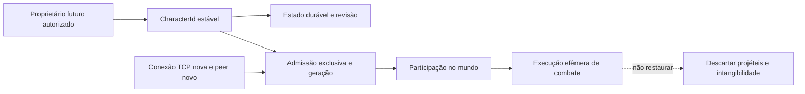
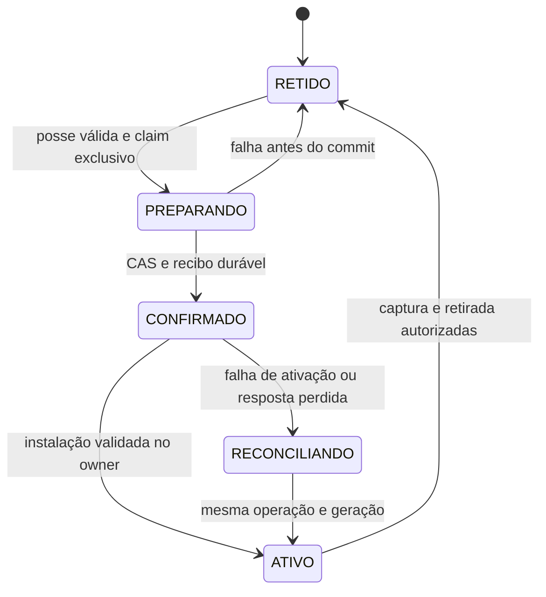

# ORG-03 — ADR de identidade e reconexão

Estado: **proposta para aprovação**, sem mudança em runtime ou protocolo.
Referência operacional: `beco@13b91dc` com alterações locais inventariadas.

## Problema confirmado

`LocalSimulationServer` aloca um `Peer.id` crescente, limitado a 1000000, por
instância do servidor; capacidade dois. O contador não é uma identidade global:
outro processo começa de novo. `RpgSessionWorld.joinCharacter` calcula UUID a
partir de `instance + ':' + id`, cria RpgWorld/atributos iniciais e novo proxy.
`instance` é um UUID novo do mundo. Mesmo nome/raça não significam mesmo personagem.

`LocalClient.reconnect()` exige conexão anterior encerrada e cria outro cliente
com os mesmos parâmetros de seleção. O servidor não recebe prova de propriedade
ou ID persistente para recuperar. A nova admissão muda UUID/peer e recomeça
progresso experimental. Não há exclusão por personagem persistente porque esse
conceito ainda não está ligado à admissão; duas conexões com mesmo nome são
permitidas e cobertas por `Task201CharacterSessionTest`.

No offline, `CharacterIdentity.create()` gera UUID aleatório que o save conserva.
Isso dá identidade ao arquivo, sem autenticar conta. `Player.connection` final
amarra o modelo por componentes a uma conexão; o RPG usa outra estrutura.
Nenhum desses fatos autoriza reescrever Player ou juntar modelos agora.

## Fronteiras propostas

| Conceito | Identificador/função proposta | Regra |
| --- | --- | --- |
| Proprietário | Referência interna futura a conta/autoridade | Prova de posse fora do snapshot; nome/IP não autenticam |
| Personagem | `CharacterId(UUID)` estável emitido pelo servidor | Não depende de IP, nome, seat, peer ou world.instance |
| Documento | `schemaVersion`, `stateRevision`, hash de conteúdo | Formato, estado e conteúdo são eixos distintos |
| Admissão | Geração monotônica por personagem, com fence | No máximo uma participação autorizada; geração anterior perde poder |
| Conexão | Peer/int e recursos TCP atuais | Trocar conexão não precisa criar personagem, quando a recuperação existir |
| Mundo | Instância/época e revisão de conteúdo | Geração do mundo não é revisão de documento |
| Execução | Geração local da técnica/mob/alvo | Não pode atravessar admissão/época por coincidência de int |

Geração durável de admissão não existe hoje no runtime. A geração de mob usada
em `targetGeneration` e a sequência de sincronização de conteúdo não a substituem.
Tipos distintos são proposta para evitar trocas acidentais, não novos tipos Java.

## Alternativas e decisão recomendada

| Alternativa | Avaliação |
| --- | --- |
| Usar nome/IP/posição na conexão | Rejeitada: não prova posse, muda/repite e colide entre pessoas |
| Persistir UUID atual derivado do peer | Rejeitada: codifica uma admissão efêmera; não resolve autorização |
| Copiar/serializar Player ou RpgWorld inteiro | Rejeitada: carrega conexão, cenário, execução e autoridade misturados |
| Identidade estável, estado explícito, admissão com geração | Recomendada: permite recuperar progresso sem reviver conexão/execução |

Não escolher algoritmo novo de UUID nem instalar biblioteca. UUID é o tipo
candidato compatível com a identidade local atual; emissão/armazenamento serão
definidos na implementação autorizada. UUID público nunca vira senha.

## Recuperação idempotente proposta

Os estados são proposta. Não há atualmente esse ciclo no multiplayer. Quando
um banco participar, commit durável e ativação em memória não serão uma única
transação mágica; ver protocolo de preparação/reconciliação no plano de persistência.

1. Transporte negocia capacidade futura separada de 6/7. Autoridade confiável
   valida proprietário e personagem; cliente não envia snapshot autoritativo.
2. Claim/lease com fence monotônico garante exclusão. Operação tem ID próprio
   e vínculo a personagem, geração, revisão esperada e conteúdo/política.
3. Preparar candidato validado e spawn reservado no owner, sem eventos, XP,
   recompensa, corpo visível ou comando ativo. Nada é somado a um personagem novo.
4. Confirmar estado/claim/recibo no armazenamento e instalar somente se geração,
   reserva e revisão ainda forem válidas. Uma falha fica retida/reconciliável;
   não libera outro dono enquanto possa existir uma admissão ativa.
5. Retry da mesma operação confirmada consulta recibo, não faz nova admissão.
   Operação com mesmo ID e conteúdo divergente é conflito. Prova é revalidada
   também na consulta do recibo; ele não entrega autorização a qualquer UUID.

Expiração de autorização/lease não apaga personagem. Um TTL para prova de posse
não é TTL do progresso, da recarga ou da retenção documental. Esses prazos
precisam de decisões separadas; não adotar os 60/1800 ticks do laboratório R3
como política real. Não criar tokens/credenciais nem login nesta entrega.

## Concorrência e comandos antigos

Hoje o peer fixa o ID de origem e o owner serializa comandos; as sequências
e hashes impedem parte do replay dentro daquela sessão. O ID crescente evita
reuso durante a instância até seu limite; restart é outra época.

Futuramente toda operação assíncrona deverá carregar `(CharacterId, geração,
época do mundo, revisão de conteúdo, operação)` e confirmar vínculo antes de
mutar o owner ou confirmar gravação. Novo socket não recebe autoridade para
reusar fila antiga. Callback de persistência da geração velha não substitui
a nova, mesmo que tenha revisão numérica alta. CAS de revisão sem fence não
resolve esse caso. Não se altera o frame wire atual nesta proposta.

Duas recuperações concorrentes: uma ganha o claim; outra recebe ocupado/conflito.
Se a primeira perdeu a resposta após commit, recebe o mesmo resultado mediante
reconciliação autenticada, sem gerar segunda participação. Não usar um mapa
`active` apenas por processo como garantia entre servidores: o laboratório
sintético tem esse limite e não é autenticação distribuída.

## Relação com A-04 e referências anteriores

R1 reproduz imunidade persistente sem apoio. R2 valida retirada coordenada apenas
em laboratório; readmissão comum recria personagem efêmero. R3 recomenda reter
estado/recargas e recuperar com posse/geração, também só em laboratório.

A futura recuperação capturaria progresso, direitos pendentes e recargas **antes**
de `skills.remove/leave`. O executor devolve recargas zero para sessão ausente:
capturar depois produziria um reset falso. Não copiar `skillIntangible`, fase,
projéteis, pendências ou eventos antigos. Sem apoio físico válido, manter estado
retido sem corpo ativo; não fabricar materialização nem reviver em obstáculo.

Não ligar timeout de 92 ticks, desconexão automática, mudança de imunidade ou
recuperação automática com base nesta ADR. A-04 continua sem correção de runtime.
Referências: [R1](TASK-225-R1-RELATORIO-FINAL.md),
[R2](TASK-225-R2-PLANO-INTEGRACAO-A04.md),
[ADR R3](TASK-225-R3-ADR-CONTINUIDADE.md).

## Gates próprios de implementação

Aprovar políticas de recursos/status/relógio, autenticação e proteção do canal,
claim/fence e falhas de ativação, DTO/validação, conteúdo/spawn, durabilidade e
feedback. Depois autorizar separadamente qualquer mudança em identidade,
reconexão, saves, protocolo ou banco. Nenhuma aprovação é inferida desta ADR.
