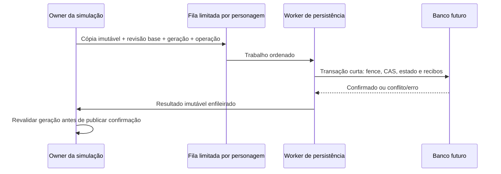

# ORG-03 — Plano conceitual de persistência

Estado: proposta para aprovação, sem SQL, migration, driver, pool ou conexão.
Alvo futuro: PostgreSQL próprio acessado **somente pelo servidor**.

## Modelo existente e o que pode ser reaproveitado

`LocalSaveStore` lê schemas 1/2 e escreve 2, rejeita duplicatas e campos
desconhecidos, valida RpgSave/restauração e mantém backup ao substituir arquivo.
Isso atende campanha local, com limites/cenário builtin; não é prova de posse
nem importador multiplayer. `CharacterSaves` cataloga/recupera/arquiva arquivos
locais e não deve ser usado como cadastro de conta. Não ler saves pessoais
para preencher a futura base sem migração autorizada.

`SyntheticOnlineRepository` envolve RpgSave em documento V1 com UUID/revisão,
SHA-256, lock de arquivo, substituição atômica e retry de snapshot inteiro
idêntico em base+1. `SyntheticSessionLaboratory` limita posse por handle local
e mapa ativo; não autentica a rede. SHA-256 detecta alteração/integridade, não
autoriza proprietário. A autoridade do grant é ligada à instância e não sobrevive
como credencial a restart. Esse conjunto é referência de CAS/retry, não novo backend.

`Task225R3RecoveryLab` está em `src/test`, mantém envelope ampliado/recargas em
memória e exclui transitórios. Não é durable store nem captura/importação reais
do RpgSessionWorld. O novo contrato precisa cobrir lacunas explicitamente.

## Agregados e relacionamentos candidatos

Nomes abaixo são rótulos conceituais, não nomes de tabelas/migrations definidos.
Não há correspondência automática entre cada classe Java e tabela.

| Agregado | Conteúdo e responsabilidade | Relação/chave lógica futura |
| --- | --- | --- |
| Identidade de personagem | UUID estável, nome, raça, cosméticos, vínculo de proprietário futuro | Raiz; proprietário pode possuir vários personagens; propriedade não é nome |
| Progressão | XP, domínio, XP em meias unidades e reset | Um estado por personagem; nível derivado |
| Atributos | Investimentos, pontos livres, checkpoint de concessão e versão da regra | Um por personagem; orçamento consistente com progressão |
| Inventário | Slots, tipo de item, quantidade e capacidade versionada | Muitos slots; único `(personagem,slot)` |
| Equipamentos | Slot RPG e item; posse transferida da bolsa | Muitos slots; único `(personagem,slotEquipamento)` |
| Moedas | Saldo e versão econômica | Um por personagem; sem inventar carteira cash |
| Missões | Aceitação, objetivos, entrega, definição/revisão, namespace | Muitos; chave inclui personagem, missão e eventual instância de repetição |
| Recibos de recompensa/operação | Chave estável, beneficiário, origem, resultado/fingerprint e revisão | Muitos; unicidade da concessão no domínio correto |
| Estado recuperável | Recursos, prazos, restrições, posição candidata e metadados de captura | Um checkpoint confirmado/revisão ou histórico com cabeça explícita |
| Revisão e posse ativa | Revisão confirmada, geração/fence, owner/lease e estado da admissão | Uma cabeça de concorrência por personagem |

Definições de raça, skill, item e missão são catálogos versionados, referenciados
por IDs. Não copiar todo o catálogo em cada personagem. Encounters/população/
contribuições globais exigem modelo próprio; não pertencem ao checkpoint individual.

Preferir fronteira transacional de personagem e seus ledgers econômicos. Em uma
primeira integração futura, um payload recuperável versionado mais cabeça CAS e
recibos pode reduzir superfície de importação; normalização seletiva permite
consultas/invariantes. A escolha entre payload e tabelas por subestado exige
medição/consultas reais. Não manter duas autoridades independentes (JSON e colunas)
para o mesmo saldo/XP sem regra única de atualização e verificação.

## Restrições futuras a validar em ambiente descartável

- PK estável, referências ao personagem e unicidade de slot/recibo/admissão.
- Quantidades positivas dentro do catálogo; XP/moedas não negativos e com
  limites aprovados; revisão/geração monotônicas e sem overflow.
- Itens iguais em slots diferentes podem ser legítimos; não criar unicidade
  de `itemId` por personagem para fingir proteção contra duplicação.
- FKs/índices escolhidos por consultas e exclusão/retensão reais; planejar
  índices para referências e lookups de recibo, sem cascata destrutiva automática.
- Temporalidade/deadlines com precisão e timezone explícitos; nenhum timestamp
  informado pelo cliente governa expiração. Clock/versão fazem parte da validação.

As constraints do banco complementam, sem substituir, catálogos e validação
autoritativa. Versão PostgreSQL/DDL/tipos físicos finais ainda não foram escolhidos.
Não exigir extensão de UUID ou outra instalação por recomendação de performance.

## Idempotência econômica

Operação de prêmio deve confirmar **efeito e recibo na mesma transação**:
XP, domínio, moedas, inventário/pendência, conclusão da missão e revisão.
Consultar e gravar recibo em transações separadas deixaria uma janela de duplicação.

Chave de missão: personagem + namespace + ID/revisão + instância de entrega
(hoje não há contrato de missão repetível; não inventar repetição por login).
Chave de morte/loot: personagem beneficiário + época do mundo + região/spawn +
geração + tipo da concessão. Chaves fornecidas pelo cliente não legitimam prêmios.
O mesmo ID de operação com payload diferente é conflito, nunca retry aceito.

Retry confirmado devolve resultado anterior, sem reaplicar. Não reconstruir
inventário/XP reexecutando quest, morte, RNG ou grant. Recibos de evento de objetivo
e de pagamento são diferentes: watermark de kill não prova que moedas foram
confirmadas. Pending loot precisa de vínculo a concessão única; coletar transfere
direito para bolsa, não produz nova recompensa.

Retenção/compactação de recibos deve preservar deduplicação durante todo o prazo
de replay/recuperação. Não apagar recibo por falta de espaço e depois aceitar o
mesmo prêmio. Política de arquivo/retensão é gate próprio.

## Escrita fora do tick autoritativo

Nenhum JDBC/lock/retry de disco no tick ou EDT. Captura coerente no owner,
sem entregar referências mutáveis ao worker. Uma escrita em voo por personagem
simplifica ordenação; paralelismo entre personagens é decisão posterior limitada.
Fila tem orçamento de itens/bytes, timeout e backpressure. Não acumular sem limite.

`stateRevision` representa a ordem lógica do estado; a escrita informa também
a revisão confirmada esperada. O CAS só aceita a base esperada, nova revisão
superior e fence atual. Um snapshot antigo que termina depois não sobrescreve
o novo. Após restart, a revisão confirmada é o piso; não recomeçar contador em zero.

Snapshots completos de posição podem futuramente ser coalescidos quando o mais
novo inclui todo o estado necessário. Operações econômicas/recibos não podem
ser descartados como snapshots visuais. Uma gravação periódica de blob não
promete perda zero de recompensas: essa garantia requer confirmação durável
ou journal transacional antes de anunciar sucesso definitivo.

Worker usa transações curtas sem chamadas de rede externas dentro do lock.
Se houver vários personagens na mesma operação futura, ordem de locks é estável
por ID. Conflito não é resolvido com last-write-wins nem retry cego de snapshot
velho; retorna ao coordenador para revalidar o comando/estado autorizado.

## Fronteira entre banco e ativação do mundo

Não existe atomicidade automática entre commit PostgreSQL e corpo em memória.
Projetar recuperação como preparação/commit/ativação reconciliável:

1. Claim exclusivo no armazenamento com fence monotônico e operação. Leitura
   recupera somente estado confirmado; outro dono não ganha acesso pelo UUID.
2. Owner valida candidato e reserva spawn limitada, ainda sem gameplay/corpo
   público. Não manter lock/transação do banco aberto esperando a simulação.
3. Worker confirma geração/claim e recibo de admissão `CONFIRMADO` por CAS.
4. Owner recebe confirmação, revalida conteúdo/reserva/geração e ativa. Mudança
   de região/revisão/ocupação pode recusar; o resultado vai para reconciliação,
   sem apagar o documento e sem liberar concorrente prematuramente.
5. Crash/resposta perdida consulta operação e estado de admissão. Após commit,
   não emitir nova geração porque a resposta sumiu. Compensação só libera posse
   depois de garantir que não reste ator autorizado com o fence anterior.

Lease/fence deve ser verificado também nas mutações/commits, não só no login.
Servidor isolado do banco não pode continuar indefinidamente com autoridade
cujo lease venceu enquanto outro admite o mesmo personagem. A suspensão/
retirada física segura exige projeto próprio; não reutilizar A-04 automaticamente.
Política de lease, reserva e reparo após crash ainda precisa de prova em testes.

## Indisponibilidade e limites de durabilidade

Recomendação para aprovação: recusar novas recuperações sem conseguir validar
posse/estado confirmado; manter dados retidos. Para personagem ativo, distinguir
estado pendente de confirmação e confirmado. Se fila/tempo limite for atingido,
bloquear novas mutações econômicas e colocar participação em contingência segura
aprovada, sem alegar salvamento nem desconectar silenciosamente com perda.
Não há autorização para aplicar esse comportamento no jogo agora.

Retry tem número/prazo limitados e mesma operação. Após resposta incerta,
consultar recibo antes de repetir. Sem journal durável, queda do processo pode
perder estado ainda não confirmado: declarar a janela real de perda. Não chamar
RAM/fila de backup persistente. O objetivo de preservar todo prêmio exige que
o resultado definitivo só seja apresentado após confirmação correspondente.

Encerramento futuro: parar novas mutações, capturar candidatos, drenar fila com
prazo finito, confirmar ou registrar pendência recuperável conforme journal
aprovado. Deadline de shutdown não autoriza fabricar sucesso. Backup/restore,
observabilidade, permissões do usuário de serviço e migrações também exigem
validação em ambiente descartável antes de qualquer dado real.

## Plano incremental e gates

1. Aprovar contratos e políticas, incluindo retenção, lease, efeitos negativos,
   recargas, recursos, erro de banco e precisão temporal.
2. Autorizar DTO/validação pura e laboratório de importação/exportação completa.
3. Validar CAS/fence/recibos e falhas memória-banco em storage substituto de teste.
4. Em autorização própria, preparar schema/migrations e testes PostgreSQL
   descartáveis, sem contas/saves pessoais. Só então decidir driver/pool.
5. Propor autenticação/capacidade negociada e integração servidor, com rollback
   e compatibilidade explícitos. Migração de saves locais não é automática.
6. Só após captura/recuperação real validada, discutir ativação de A-04 em tarefa
   própria. ORG-04, PostgreSQL e TASK-226 não são iniciadas por este plano.

Fundamentos consultados: skill local de boas práticas PostgreSQL, referências
de constraints, chaves, índices de FK, transações curtas e ordem de locks.
Foram usados como orientação conceitual, sem executar os exemplos SQL.
