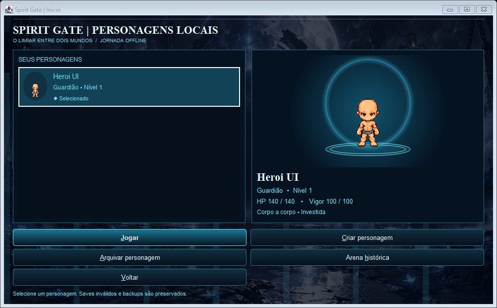
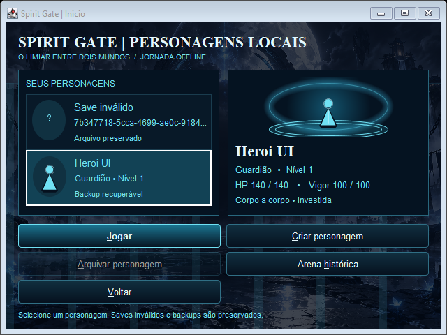

# TASK-116 — Relatório final

A seleção local recebeu fundo da entrada aprovada, painéis escuros com detalhes ciano, cards com miniaturas e estados de seleção/foco, portal com plataforma espiritual, personagem com respiração discreta e resumo de classe, nível, HP, vigor e estilo de combate. Jogar tem destaque principal, acompanhado da criação e das ações auxiliares.

O fluxo da TASK-115 continua nos mesmos controles e serviços. Nenhuma alteração desta tarefa modifica saves, backups, protocolo multiplayer, Coop ou arena histórica. A mudança em `RpgMenu` limita-se a carregar a arte opcional fora da EDT. Alterações anteriores do workspace foram preservadas, com checkpoint antes e depois em `.task-checkpoints/TASK-116/`.

**Validação final: 386 testes, 0 falhas, 0 erros, 0 ignorados.** O probe de janelas reais passou com escala padrão e 150%, usando dados temporários. Foram registradas capturas de lista vazia, sprite, save inválido, backup e fallback, incluindo janelas de 1000×620, 800×600 e 640×480. [Detalhamento dos testes](TASK-116-TESTES.md).

## Limitações e avaliação humana

- A arte de personagem continua sendo o sprite experimental existente; sem sprite, a representação geométrica é intencional e permanece funcional.
- O portal e a plataforma são composições Java2D, sem novos assets ou dependências. Em 640×480 a prévia encolhe para preservar informações e ações.
- Nomes/arquivos longos são abreviados na lista, com descrição completa no tooltip. Avisos de backup e inválido permanecem visíveis.
- As capturas válidas são de `printAll`. Robot retornou preto, e a tentativa em 150% não substitui revisão em monitor físico. O subtítulo decorativo pode sofrer recorte na captura escalada; ações e dados principais permanecem acessíveis.
- Percurso físico de Tab/Shift+Tab, teclado e aprovação artística continuam pendentes de revisão humana. Não há aprovação humana implícita nos testes automatizados.

Implementação e validação técnica entregues. A tarefa para na TASK-116 para avaliação humana; TASK-117 não foi iniciada.
