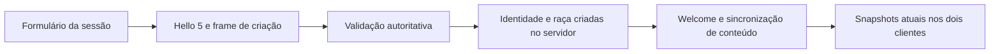

# TASK-201 — criação de personagem multiplayer e fluxo de janelas

Auditoria e aprovação: 27/10/2026. Fechamento local: 28/10/2026.
**Implementada e validada localmente, com fontes congeladas.**
A aprovação incluiu a aplicação negociada 5, o frame de criação, o fallback
Human identificado para Aetheri/Spirit e a redução das janelas de entrada.
A TASK-202 não foi iniciada. O [plano original](CORUJAO-VII-PLANO.md) permanece
preservado, com adendo de execução.

## Baseline conferido

- Branch `beco`; HEAD `6d72c6595dee6dbe4dea832fe6047ee81f51d4a3`.
- Distribuição presente: `dist/SpiritGate-GitHub-0.201.0`; canal GitHub.
- Antes desta tarefa: 26 arquivos modificados, 2.432 exclusões e 40 entradas
  não rastreadas no status resumido. Incluem a limpeza autorizada, correções
  anteriores de rede, colisão e sprites e as ferramentas novas do launcher.
- Fontes, assets e comandos protegidos por SHA-256: 1.242 arquivos.
  Oito arquivos pessoais em saves/projetos também foram conferidos sem mudanças.
- Checkpoint: `.task-checkpoints/TASK-201/corujao-vii/`, com estado Git,
  diff anterior, snapshot de fontes e resultados novos da auditoria.
- O Corujão VI foi informado como aceito pelo responsável. Os documentos
  antigos ainda registram ressalvas locais; o aceite informado não é convertido
  em nova execução Radmin entre computadores.

## 1. Arquitetura encontrada na auditoria — baseline histórico

Esta seção descreve o estado anterior à implementação. A atribuição por
assento continua apenas no ingresso legado V1–V4; o caminho novo usa a
escolha confirmada pelo jogador.

Na auditoria, o caminho dos pacotes passava por `SpiritGateEntry` e
`RadminSessionPanel`. O anfitrião iniciava o servidor e entrava como jogador em
ações separadas; o Convidado conservava a restrição de hospedagem. A conexão
usava `LocalClient.revision`, aplicação 4 com sincronização de conteúdo.

| Fonte inspecionada | Resultado |
|---|---|
| `prototype/rpg/SpiritGateEntry.java:33–38` | Entradas Hospedar/Entrar abrem `RadminSessionPanel`. |
| `prototype/rpg/RadminSessionPanel.java:16,34,59` | Campos de conexão e nome; conecta em V4 e abre a janela de jogo. Não escolhe raça. |
| `prototype/rpg/LauncherSession.java:19` | Cria `RpgSessionWorld` com a lista `reaper,human`. |
| `multiplayer/RpgSessionWorld.java:29,61–74` | O assento disponível determina a raça. Assento 0 recebe Reaper; assento 1 recebe Human. |
| `multiplayer/LocalSimulationServer.java:10,36,53–65` | IDs atribuídos pelo servidor; admissão e comandos encaminhados à thread proprietária da simulação. |
| `multiplayer/RpgSessionWorld.java:17,73,129` | UUID efêmero derivado de instância aleatória do mundo + ID; não depende do nome. |
| `multiplayer/LocalClient.java:64` | Reconexão conserva nome/transporte, mas cria outra sessão. Ainda não existe escolha de raça para conservar. |
| `rpg/CharacterRaces.java:10–21` | Já reconhece Reaper, Human, Aetheri e Spirit e suas regras iniciais. |
| `multiplayer/NetworkPlayerVisuals.java:10–23` | Resolve atlas Reaper ou Human; raças sem atlas próprio recebem o corpo Human. |

Os caminhos da tabela partem de `server/src/main/java/com/projetok/`.
O registro de raças aplicável à criação RPG é `rpg.CharacterRaces`.
`domain.race.RaceRegistry` é outro catálogo genérico de entidades, usado também
pelo Coop histórico; não precisa ser reconstruído para esta tarefa.

A atribuição fixa foi confirmada no código e no contrato de testes:
`RpgSessionServerTest.java:15`, `NetworkCosmeticsTest.java:17` e
`FinalNetworkIsolationTest.java:16` esperam o comportamento histórico.

### Fluxo offline existente

`CharacterCreation.java:40–46,99–115` já oferece quatro raças, validação,
confirmação e cancelamento. Porém, o callback em `RpgMenu.java:26,42` cria
`RpgWorld` e grava `LocalSaveStore`. `RpgLauncher` conduz esse mundo offline.
Não se deve chamar esse fluxo para criar uma sessão multiplayer.

`CharacterIdentity.java:12–16` normaliza e valida o nome. O componente
histórico `archetype` já representa uma raça, com alias `race()`; seu formato
de save será preservado. A aparência offline `azure/amber` não equivale aos
cosméticos de rede e não recolore os PNGs atuais.

### Assets necessários à TASK-201

Esta é a verificação mínima para a prévia; não inicia o catálogo completo
de ações/animações previsto para a TASK-202.

| Raça | Arquivos reais disponíveis | Comportamento visual atual |
|---|---|---|
| Reaper | 36 PNGs 64×64: 4 Idle e 32 Walk, quatro direções | Escala nativa 1×, pivô `(32,60)`, 125 ms/quadro. |
| Human | 20 PNGs: 4 Idle e 16 Walk, quatro direções | Normalização 0,4× para canvas lógico 64×64; 250 ms/quadro. |
| Aetheri | Nenhum atlas dedicado localizado | Corpo Human provisório. |
| Spirit | Nenhum atlas dedicado localizado | Corpo Human provisório. |

Fontes: `rpg/reaper-player.properties`, `rpg/experimental-player.properties`
em resources, `RpgPlayerSprites.java:66–98` e `NetworkPlayerVisuals`.
O catálogo temporário contém três cabelos e três roupas, com 180 camadas/poses.
Ele é vinculado ao corpo Human (`CosmeticCatalog.java:32–36`). O renderer
desliga esses acessórios para Reaper (`RpgNetworkClientLauncher.java:51`).

## 2. Lacunas identificadas na auditoria

1. Falta um formulário de personagem de sessão antes da conexão, com raça e prévia.
2. A raça precisa alimentar a identidade e as regras no servidor, e não somente a imagem.
3. `Hello` leva apenas versão de aplicação e nome; `AppearanceRequest` só cabelo/roupa.
4. A reconexão ainda não possui uma escolha explícita para transportar.
5. A interface não informa o fallback Human de Aetheri/Spirit nem a ausência
   de acessórios compatíveis com Reaper.

## 3. Arquitetura aprovada e implementada

### Formulário e modelo de sessão

Foram criados o painel `SessionCharacterCreation` e o modelo imutável
`SessionCharacterSelection`, com nome, raça, cabelo e roupa. O painel é
embutido na conexão modal Radmin, sem janela adicional própria. Reutiliza
`CharacterRaces`, estilo visual e validação, sem chamar a seleção de slots
offline, `LocalSaveStore` ou contas online.

- Nome com as regras atuais, normalizado antes do envio.
- Quatro raças e prévia baseada na mesma resolução visual usada no mundo.
- Aetheri/Spirit: aviso **“aparência Human provisória; sem atlas próprio”**.
- Reaper: acessórios `none`, com aviso de ausência de recursos compatíveis.
- Human e fallbacks compatíveis: escolhas somente do catálogo instalado.
- Aetheri/Spirit usam o raster Human existente, com aviso explícito.
- Atlas necessário ausente ou recusado pelo carregador: aviso e confirmação
  bloqueada, sem apresentar recursos indisponíveis como concluídos.
- Recursos carregados fora do EDT; mudança de seleção redesenha recursos em memória.
- Confirmar uma vez para conectar; sair da escolha antes dessa confirmação
  não abre conexão nem grava save. Se o worker terminar enquanto o anfitrião
  decide cancelar, o resultado aguarda a decisão; cancelar libera os recursos
  e recusar o cancelamento permite concluir a entrada.

A seleção vale para a conexão experimental atual. Não cria uma coleção de
personagens persistentes, nem recupera personagem de outro jogador pelo nome.
Nomes iguais continuam permitidos conforme o comportamento atual; IDs e
UUIDs gerados pelo servidor isolam as identidades.

### Extensão negociada de aplicação

O envelope binário atual é **V1**, inclusive quando `Hello.version` vale
2, 3 ou 4. Estes números negociam capacidades da aplicação.
`Protocol.read` recusa bytes excedentes (`Protocol.java:95`), portanto
acrescentar campos ao Hello antigo quebraria seus leitores.

Foi implementada a **aplicação 5**, herdando os recursos da aplicação 4 e
acrescentando criação explícita de personagem. O Hello e os opcodes 1–15
conservam seus bytes. O novo frame `CharacterCreate`, opcode 16, leva
raça/cabelo/roupa depois de `Hello(5,nome)` e antes de `Welcome`/entrada
no mundo.

O servidor valida o perfil e admite o jogador de uma vez na thread da
simulação. O cliente não define ID, UUID, atributos, spawn, itens ou domínio.
A implementação reutiliza `CharacterIdentity`, `RpgWorld` e snapshots de aparência existentes.
O assento continua definindo posição/capacidade; deixa de definir a raça no
caminho novo. A criação não é aceita como comando para trocar raça no
meio de uma sessão já admitida.

A reconexão mantém a escolha no cliente e cria uma nova identidade efêmera
no servidor, preservando a semântica atual de “reconectar nova sessão”.

### Compatibilidade e publicação de mapas

| Combinação | Comportamento implementado |
|---|---|
| Cliente V1–V4 → servidor novo | Frames e ingresso históricos preservados, incluindo raça por assento no caminho legado. |
| Cliente novo → servidor novo | Escolha explícita validada antes da admissão. |
| Cliente novo → servidor antigo | Erro claro pedindo atualização, sem ignorar silenciosamente a raça escolhida. |
| Coop/servidor sem capacidade nova | Não anunciar suporte à seleção que não consegue cumprir. |
| Publicação com peer legado | Preservar bloqueios existentes; não promover V1–V3 a clientes de conteúdo. |

Compatibilidade conserva os recursos que cada aplicação já conhecia. Um
cliente V1 sem aparência negociada não passa a renderizar novas raças;
as provas da seleção completa usaram dois clientes novos.

Na auditoria, `RevisionCoordinator.java:60,79,81,92` comparava literalmente aplicação 4.
Os gates passaram a reconhecer a nova capacidade negociada, conservando
barreiras, ACKs, rollback e recusa de peers antigos após conteúdo incompatível.
O schema de `WorldContent` e sua tag histórica foram preservados, pois
o conteúdo dos mapas não foi alterado por esta tarefa.

Regras novas de combinação raça/cosmético ficam no caminho negociado novo;
não modificar globalmente os pedidos legados sem necessidade.

## 4. Arquivos da implementação

Produção, partindo de `server/src/main/java/com/projetok/`:

| Arquivo | Alteração realizada |
|---|---|
| `multiplayer/SessionCharacterSelection.java` | Perfil efêmero validado, sem identificador escolhido pelo cliente. |
| `prototype/rpg/SessionCharacterCreation.java` | Painel, prévia e limitações; confirmação/cancelamento pertencem ao modal Radmin. |
| `prototype/rpg/RadminSessionPanel.java` | Confirmar escolha antes da conexão, preservando hospedar/entrar separados. |
| `multiplayer/Protocol.java` | Aplicação opt-in e frame novo; bytes antigos preservados. |
| `multiplayer/SessionSimulation.java` | Capacidade e ingresso explícito, mantendo métodos legados. |
| `multiplayer/LocalSimulationServer.java` | Fase de criação validada antes da admissão/Welcome. |
| `multiplayer/LocalClient.java` | Handshake escolhido e perfil mantido para reconexão. |
| `multiplayer/RpgSessionWorld.java` | Criar mundo com a raça aceita; validar cosméticos no caminho novo. |
| `multiplayer/RevisionCoordinator.java` | Reconhecer aplicação nova nos gates de conteúdo. |
| `multiplayer/NetworkPlayerVisuals.java` | Expor à prévia a resolução/fallback já existente. |
| `multiplayer/RpgNetworkClientLauncher.java` | Perfil na reconexão, apresentação recebida do worker e cosméticos compatíveis. |
| `prototype/rpg/SpiritGateEntry.java` e `RpgMenu.java` | Marcar telas de navegação e identificar o dono da conexão modal. |
| Novos `prototype/rpg/SessionWindowNavigation.java` e `SessionGameLifecycle.java` | Fechar a navegação ao entrar; transferir o servidor à partida e conservar sua posse na reconexão. |

`RpgLauncher`, saves pessoais, schemas e persistência sintética permanecem
fronteiras de regressão. A mudança em `RpgMenu` se limita à navegação.
Os assets originais não foram editados. O escopo adicional aprovado alterou
`tools/updater/Launcher-SpiritGate.ps1` e `Atualizar-SpiritGate.ps1` para
transferir a execução ao processo do jogo e fechar o launcher após a confirmação
de abertura. Os testes correspondentes estão em [TASK-201-TESTES.md](TASK-201-TESTES.md).

## 5. Riscos e controles

- **Compatibilidade:** não ampliar frames antigos nem fazer downgrade silencioso.
- **Admissão incompleta:** limitar leitura/tempo/fila e liberar capacidade em erro,
  perfil ausente, duplicado, inválido ou desconexão.
- **Autoridade:** validar o perfil no servidor e recusar criação fora de fase.
- **Conteúdo:** testar ingresso, publish, rollback e reconexão em mistura V4/nova aplicação.
- **Identidade:** manter IDs/UUIDs da sessão, sem transformar nome em chave de conta.
- **Offline:** formulário separado; nenhuma escrita em saves ou integração sintética.
- **Arte:** fallback identificado; Reaper preservado; sem novas imagens ou ajuste de hitbox.
- **EDT:** sem sockets ou carregamento de imagens no evento de renderização.

## 6. Validação

O baseline, a matriz executada e as evidências estão em
[TASK-201-TESTES.md](TASK-201-TESTES.md). A implementação foi verificada com:

1. Formulário real, quatro raças, confirmação/cancelamento, nomes válidos e inválidos.
2. Round-trip/limites do frame novo e golden bytes V1–V4 preservados.
3. Servidor TCP real e dois clientes: Reaper/Human, ordem invertida e duas raças iguais.
4. Identidades distintas para nomes iguais; reconexão mantém escolha e recebe novo UUID.
5. Perfis inválidos e fora de fase não criam personagem nem alteram o outro jogador.
6. Dois renderizadores mostrando os perfis autoritativos, com capturas da tela nova e do mundo.
7. Conteúdo, publicação/rollback, colisão, combate, offline/saves e launcher sem regressões.
8. Conclusão do worker durante cancelamento Radmin, reconexão durante confirmação
   de encerramento e falha de rede depois de fechar a janela, sem ingresso ou modal tardio.
9. Falha ao gravar a confirmação WinForms encerra somente o processo recém-criado
   e aguarda a saída antes de liberar o lock; processos anteriores são preservados.

A rodada final compilou 243 fontes e 209 arquivos de testes Java: 671 casos
executados, 651 aprovados em headless, 20 abortados por exigir GUI e nenhuma
falha ou skip. O complemento Swing aprovou 28 execuções, cobrindo os 20 abortos
e repetindo oito casos já aprovados. Python aprovou 97 testes; as regressões
PowerShell aprovaram 39 verificações do atualizador e 21 do transporte GitHub.
As fontes permaneceram estáveis durante a rodada final.

## 7. Aprovação e fluxo de janelas

Depois da auditoria, o usuário aprovou expressamente a implementação da
TASK-201 e acrescentou o ajuste do fluxo de janelas. A proposta de aplicação
opt-in 5 e frame de criação deixou de ser uma decisão pendente.

O fluxo implementado é:

1. O launcher verifica a instalação e inicia o processo do jogo. Fecha sua
   interface após receber a confirmação de um processo ainda vivo.
2. A conexão Radmin abre como `JDialog` modal, pertencente à tela de entrada.
   O formulário de personagem fica dentro desse modal.
3. Depois da entrada efetiva, o modal e as telas de navegação identificadas
   são descartados. Editores e outras partidas não são fechados por essa ação.
4. O servidor iniciado pelo anfitrião passa a ser propriedade da partida.
   Ele continua vivo ao fechar a navegação e ao substituir a janela durante
   uma reconexão. O encerramento confirmado da janela final encerra o servidor.
5. A prévia, o mundo e a reconexão reutilizam a mesma apresentação carregada
   pelo worker, evitando resolver outro atlas a partir do diretório de execução.

A confirmação do launcher atesta processo vivo após a checagem inicial;
não significa que o mundo ou a conexão TCP já terminaram de carregar.
Falhas imediatas de abertura mantêm a interface do launcher recuperável.
A confirmação de cancelamento Radmin já é coordenada com a conclusão do
worker. Na partida, uma reconexão que termina durante a confirmação de
encerramento é descartada, liberando sua conexão; recusar o fechamento
mantém o anfitrião e permite tentar novamente. Aceitar encerra a partida
sem outra janela substituir a decisão. Erros tardios não reabrem modais
depois de a janela ter sido descartada.

Se a gravação do ACK falhar após iniciar Java, o engine encerra somente o
processo recém-criado e aguarda a saída antes de liberar o lock. Se não
conseguir encerrá-lo imediatamente, conserva a supervisão até confirmar a
saída. Os testes dessas situações e da apresentação compartilhada estão
registrados em [TASK-201-TESTES.md](TASK-201-TESTES.md).

A revisão contra o checkpoint anterior está em
`implementation/task201-source.patch` e `implementation/source-changes.json`,
sob `.task-checkpoints/TASK-201/corujao-vii/`. São 26 arquivos de código/testes:
14 existentes alterados e 12 novos, preservando as mudanças anteriores.

## 8. Disponibilidade e próximo passo

As mudanças estão nos fontes locais e nas evidências desta TASK. A distribuição
pública `dist/SpiritGate-GitHub-0.201.0` permanece imutável, com seus executáveis
e scripts já publicados. Ela não recebeu a seleção nova nem o novo fluxo de
janelas apenas por esses fontes terem sido alterados. Nenhuma atualização
pública foi anunciada ou enviada, e nenhum pacote novo foi gerado nesta tarefa.

Para testar os fontes atuais, execute `rodar-prototipo.cmd` e use as opções
Radmin no Portal de entrada. `jogar-rpg-offline.cmd` é um alias desse caminho.
Esse teste executa o código Java novo; o EXE da distribuição 0.201.0 continua
executando sua entrega anterior. A mudança WinForms será distribuída somente
quando um pacote posterior for preparado e autorizado para publicação.

A validação desta tarefa usa servidor e clientes TCP reais no mesmo computador.
Não houve teste novo em dois computadores ou Radmin físico, nem aprovação
artística humana das capturas. Aetheri/Spirit continuam com aparência Human
provisória; Reaper não ganhou acessórios nem imagens novas.

A TASK-202 continua não iniciada. O Gate A depende também dela; esta entrega
não fecha o Corujão VII. O próximo passo é revisão do responsável e uma nova
instrução para avançar, preservando o escopo e as restrições do plano.
