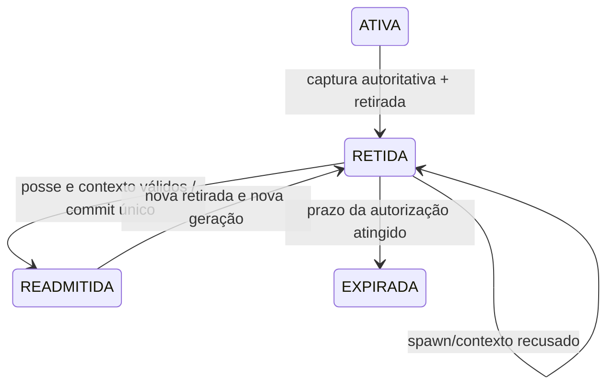

# TASK-225-R3 — ADR de continuidade do personagem

Estado: **proposta para decisão do responsável**, elaborada na execução de 03–04/11/2026. R2 validou retirada equivalente em laboratório. A-04 permanece bloqueante; nenhuma política foi ativada. A autorização direta para commit/push da R3 é uma exceção específica à restrição de Git do anexo, sem autorizar publicação ou integração de runtime.

## Recomendação

Recomendar **B, retirada finita com estado retido e recuperação controlada**, como caminho de menor risco para preservar progresso. Não ativar o prazo enquanto a captura completa, a posse confiável, as recargas e a admissão transacional não estiverem implementadas e validadas. A expiração da autorização de recuperação não deve significar apagar silenciosamente o personagem.

A não atende ao objetivo de conservar conquistas; C não garante término em cenário sem qualquer apoio válido. B permite terminar a participação física sem decidir que o personagem precisa ser perdido. A R3 comprova apenas mecanismos locais de B, não uma recuperação segura de multiplayer ou de contas.

## Auditoria das responsabilidades atuais

| Dono | Dados/mecanismos encontrados | Implicação |
|---|---|---|
| Personagem (`RpgWorld`) | `CharacterIdentity`/raça, domínio/XP fracionária, XP/nível derivado, HP, energia, inventário, equipamento, moedas, atributos manuais, missões | Preservar por identidade confiável; não usar `joinCharacter` comum e depois somar ganhos. |
| Missões (`QuestService`, `AuthoredQuestSession`, `QuestRewards`) | Objetivos, flags de conclusão, recibos de eventos, plano transacional de recompensa; autoria tem `copy()` em memória | Restaurar ledger e recursos juntos. Não reexecutar mortes/entregas para reconstruir progresso. |
| Execução (`RpgSkillEngine`) | `Session.ready[5]`, mundo/região/domínio, pendências, DoTs, projéteis, sentinela, marcas e eventos visuais | Capturar recargas **antes de `remove`**, que apaga a sessão; não restaurar execução/phase. `state()` de sessão ausente devolve zeros e não é uma captura válida após saída. |
| Participação (`RpgSessionWorld.Session`) | ID/seat, mundo/proxy, aplicação, sequência compartilhada de comandos, alvos, movimento/facing/home, aparência | Nova admissão tem nova geração/ID de peer; identidade do personagem pode permanecer. Descartar filas/alvos/movimento antigo. |
| Mundo (`SharedRpgEncounter`) | População/generações de mobs, contribuições e eventos/recompensas, mapa de mundos participantes | Não restaurar população/ledger global a partir de save individual. Vincular recibos de recompensa ao personagem estável; não premiar novamente por recuperar. |
| Revisão (`RevisionCoordinator` e `RpgSessionWorld`) | Hash ativo, admissão/sincronização de conteúdo, bloqueio/congelamento e troca de revisão | Hash e época de mundo fazem parte da compatibilidade da recuperação. Mudança requer recusa ou migração aprovada. |
| Interface (`SessionSimulation`) | `join`, `leave`, `disconnectRequested`, snapshots privados e comandos | Contrato atual não oferece importação completa de personagem nem prova de recuperação. |
| Conexão (`LocalSimulationServer`) | Sockets, peer/ID monotônico, filas limitadas, capacidade dois, owner e departures | Não reutilizar socket/ID antigo; capacidade liberada não é autorização para assumir personagem retido. |
| Cliente (`LocalClient`, `GameplayProtocol`) | Ficha/energia/skills e reconexão explícita com nova criação; pedidos sequenciados | Ficha é apresentação parcial, não backup/autorização. Não aceitar XP, itens, cooldown ou snapshot enviados pelo cliente. |
| Laboratório 193–196 | `SyntheticOnlineRepository`, `SyntheticSessionLaboratory`, `Task196ResumeHarness` | CAS, grant/handle local, checksum, retry idêntico e arquivos sintéticos. Não autentica rede e não cobre automaticamente o estado multiplayer atual. |

`SharedRpgEncounter.leave` retira o mundo do mapa de participantes vivos; contribuições de gerações de inimigos podem continuar no ledger global até a resolução da morte. Isso exige política de identidade estável/recompensa futura e testes próprios na integração, não limpar ou copiar o ledger indiscriminadamente.

## Lacunas do save e das cópias existentes

`RpgSave`/`RpgWorld.save()` cobrem identidade, região/posição, HP, XP, moedas, inventário/equipamento, missões builtin, flags e ticks. Domínio e alguns prazos ficam nas flags. Não constituem um snapshot completo do multiplayer:

- Atributos manuais, pontos e estado de habilitação não constam do payload. Energia salva usa normalização, enquanto o mundo atual também tem energia absoluta, máximo por atributos e resto de regeneração; não presumir round-trip exato desses dados por `stamina`.
- As cinco recargas de `RpgSkillEngine` pertencem a outra classe e não são persistidas; seu próprio Javadoc afirma isso. Recarga precisa ser capturada no owner antes do cancelamento, e reinserida por API explícita futura.
- `AuthoredQuestSession` tem ledger separado, não exportado no save builtin. Retomada de missões autoradas exige contrato completo com progress/flags/recibos, não apenas os `View`s.
- `preciseAttackReady`, estado relevante de atributos/energia e outras temporizações não equivalem a todos os inteiros apresentados em `GameplayProtocol.Abilities`. Não reconstruir autoridade pela ficha do cliente.
- Flags de mobs e coordenadas de cenário builtin não devem ser importadas para um encontro autorado compartilhado. `RpgWorld.restore()` cria o mundo builtin e sua geometria; não é importador do mapa/revisão multiplayer.

`forkSyntheticRevision` já copia vários desses dados e missões autoradas em memória, preservando identidade; é destinado a troca de conteúdo com validação de todos os participantes. Não transporta `RpgSkillEngine.Session`, não autentica readmissão e não deve ser reaproveitado silenciosamente como arquitetura de recuperação. `forkSynthetic` tem restrições próprias de mapa padrão/autoria. São referências úteis para localizar campos, não uma integração pronta.

Os grants do repositório 193–196 são capacidades locais ligadas a uma instância. `resume(UUID)` é seleção pelo controlador confiável do laboratório, nunca prova suficiente recebida de cliente. SHA-256 é integridade, não autenticação. A R3 não modifica esse contrato nem o conecta ao servidor.

## Comparação de políticas

| Política | Vantagem | Risco/complexidade | Decisão proposta |
|---|---|---|---|
| A — encerrar e reinicializar | Reusa fluxo atual; término físico finito | Perde conquistas; libera recargas; nome igual mascara personagem novo | Rejeitar como correção transparente. Só admissível se contrato experimental e perda forem explicitamente aceitos. |
| B — retirar e recuperar | Separa término físico de perda de personagem; preserva estado autorizado | Requer posse, snapshot completo, consumo único, identidade estável, relógio e admissão transacional; durabilidade é outro escopo | Recomendada com gates. Não ativar apenas porque o protótipo passou. |
| C — recuperar na mesma participação | Mantém vínculo/conexão e evita readmissão | Busca não garante apoio em mundo totalmente ocupado; reserva pode ser invadida/invalidada; deslocamento para outra região altera gameplay | Não recomendar como garantia isolada de término. Exigiria regra física explícita e reserva validada ou fallback B aprovado. |

Em C, origem anteriormente livre não significa apoio livre agora. Uma posição reservada exigiria manter cenário, corpos, região e revisão compatíveis e impedir sua ocupação, alterando regras do mundo. Remover imunidade dentro de obstáculo ou teletransportar para coordenada arbitrária é inválido. A R3 não implementa reserva ou deslocamento.

## Contrato candidato de B e dados recuperáveis

O registro futuro deve conter identidade opaca de personagem, prova de posse, geração de admissão, geração/época de mundo e execução, versão/schema, revisão de conteúdo, snapshot limitado autoritativo, prazos de recuperação e estado transacional. A prova não é nome/IP/ordem de conexão. A posse de outro personagem, instância ou geração é recusada.

| Dados | Política proposta | O que o protótipo prova |
|---|---|---|
| UUID/raça/aparência | Manter personagem; novo peer/geração | Identidade/raça no `RpgSave` mantidas; credencial local opaca. Cosméticos da sessão real não são importados. |
| Domínio, XP/nível | Snapshot exato; nível derivado do XP | Domínio real, nível 15 derivado e XP preservados sem nova concessão. |
| HP/energia | Congelar valores no desligamento; sem cura/refill gratuito; máximo validado por atributos | HP exato e energia explícita 430/1000 preservados no envelope; aplicação de energia/atributos ao runtime não implementada. Morto não deve ser revivido por recuperar. |
| Inventário/equipamento/moedas | Substituir snapshot inteiro, não mesclar/somar | Dados reais builtin e mapas imutáveis conservados; repetição não soma itens. |
| Missões/objetivos/recibos | Preservar progresso e conclusão; não reaplicar eventos | Missão builtin parcial e recompensa real do harness 196; autoria apenas DTO sintético imutável, sem importar `AuthoredQuestSession`. |
| Cooldowns | Deadlines autoritativos para cinco skills e ações comuns; mesma época de relógio | Modelo conserva todos os campos obrigatórios; skill cinco pronta no tick 900 continua com 750 ticks aos 150. Não injeta deadlines no engine. |
| Recompensas já concedidas | Recursos e recibos no mesmo commit; manter identidade frente a contribuição pendente | Snapshot/recibos locais e replays reais builtin de baú/missão; não prova exactly-once distribuído nem ledger multiplayer. |
| Região/posição | Revisão/época/região compatíveis e apoio validado no owner | Contexto diferente recusado; geometria builtin real recusa posição obstruída. Não implementa busca de outro spawn. |
| Atributos/pontos | Preservar distribuição e não reconceder pontos por readmissão | Mapa limitado de atributos no DTO; restaurador real e orçamento de pontos não implementados. |

O protótipo tem nove deadlines obrigatórios: cinco skills, ataque, shunpo, poção e portal. Trata-se de contrato de investigação, não inventário exaustivo do runtime. Antes da integração, cobrir também temporizações precisas, ações cobradas e efeitos prejudiciais relevantes. Buffs/controle com custo não podem ser apagados para oferecer vantagem; aprovar preservação por deadline ou regra compensatória. A ausência de campo obrigatório deve recusar recuperação, nunca assumir zero.

Projéteis, pendências, animações, seleção de alvo, filas de comandos, referências de socket e intangibilidade bloqueada não são estado recuperável. Efeitos globais/contribuições não são copiados de volta ao mundo. O protótipo descarta explicitamente os transitórios; não resolve no engine a política de efeitos com custo.

## Máquina de estados e atomicidade

No modelo, operações sincronizadas protegem captura/ticket/handle; dois threads reais competem por um ticket e só um vence. Não se declara transação distribuída. O callback de spawn é código local confiável e finito, não hook de plugin/cliente. Ele não deve reentrar no controlador ou fazer I/O externo; no patch futuro a preparação/ativação real precisa de contrato de commit próprio.

Antes do commit, falha simulada mantém estado retido e ticket utilizável dentro do prazo. Depois do commit, resposta perdida deixa uma única geração ativa e um recibo consultável pela mesma prova e operação; retry não recebe nova admissão. O recibo não emite outro handle nem resolve entrega de credencial em rede. Em produção será preciso reconciliar o peer não confirmado sem duplicar posse, por protocolo próprio e lease/timeout definidos.

Ticket expira no limite exclusivo (`now >= expires`), não é renovado por tentativa. No fixture: retirada aos 100, TTL 60 ticks, aceita 159 e recusa 160/161. O limite de 1.800 ticks no protótipo é apenas proteção de ensaio; não é política aprovada de produto. Snapshot expirado continua retido na instância e nunca vira novo personagem com reset automático. O laboratório retém no máximo dois registros e não implementa coleta/arquivo/recuperação de expirados; isso limita o ensaio, não altera capacidade real nem representa política de retenção concluída.

O relógio de cooldown é monotônico e controlado pelo servidor; região/revisão/época divergentes são recusadas. Se o processo reiniciar e os ticks retrocederem, não reinterpretar deadline antigo como zero. Persistência de prazo exigirá definição própria (época durável, tempo confiável e migração); não usar hora do cliente. O protótipo **não sobrevive a restart**: nova autoridade recusa tickets anteriores e não há backup do envelope.

## Integração futura com A-04 (não implementada)

1. Preservar 32 ticks normais e quatro impactos únicos; tolerância proposta de 60 ticks. No 92, última tentativa de apoio antes de declarar falta definitiva.
2. No owner, revalidar geração de personagem/admissão/execução, região e revisão. **Capturar estado completo, recibos e recargas antes de `skills.remove`/`leave`**. Não capturar zeros de sessão já removida.
3. Preparar registro de continuidade e sua confirmação no mesmo domínio de serialização do estado de personagem. Falha de captura exige contingência aprovada; não silenciar perda nem ligar timeout antes dessa solução. I/O futuro não pode bloquear indefinidamente o owner; definir orçamento, backpressure e caminho de erro.
4. Com registro confirmado, executar retirada coordenada da R2: limpar engine/transitórios, remover mundo/sessão/encontro, conservar pedido de transporte, fechar peer antes de snapshots privados, recusar comandos antigos. Um término físico finito não promete readmissão imediata.
5. Nova conexão negocia recuperação separadamente, prova posse e solicita operação idempotente. O owner verifica expiração, compatibilidade e spawn contra corpos atuais; instala estado e deadlines por APIs explícitas, sem reaplicar recompensas nem reconceder pontos.
6. Consumir ticket e confirmar uma única admissão; emitir recibo/ficha novos só após commit. Liberação do peer antigo não basta para recuperar outro personagem. Perda de resposta exige reconciliação por geração/lease.

Não se apresenta a cópia de estado do protótipo como cumprimento desses passos no runtime. A captura e a instalação reais, incluindo falhas de processo durante a transição, ainda não existem.

## Proposta separada de autenticação/recuperação

Aplicações 6/7 não serão modificadas silenciosamente. Propor capacidade negociada com versão própria, sem escolher um número antes de revisar o catálogo de protocolos. Ela deve definir: prova opaca emitida apenas ao peer autorizado por canal protegido, não por UUID público; vínculo ao contexto experimental/servidor; prazo/rotação/revogação; geração/ID de operação; resultado de recuperação/recusa/expiração/pendência; confirmação e reconciliação de resposta perdida; proteção contra replay/bruteforce; tamanhos e rate limits.

Um bearer token entregue em TCP sem proteção não é autenticação segura contra observador da rede. TLS ou proteção equivalente, armazenamento da credencial no cliente e ameaça do ambiente exigem decisão própria, sem instalar nada nesta R3. Não usar endpoint administrativo ou mensagem de debug para preencher essa lacuna. Clientes 6/7 continuam no contrato efêmero atual, sem falsa indicação de recuperação; decidir fallback explícito antes da ativação, inclusive recusar recuperação em cliente incompatível sem reset silencioso.

Contas reais, login público, saves pessoais e recuperação após perda do processo não fazem parte desse protótipo. O repositório sintético pode inspirar CAS/commit/recibos, mas qualquer durabilidade do novo envelope requer projeto e aprovação separados. Não promete proteção contra administrador local ou processo comprometido.

## Evidência, limitações e decisão requerida

Os testes estão em `Task225R3RecoveryLabTest`: recuperação exata do envelope, duplicação/itens, prova errada, expiração, corrida, spawn real/simulado, revisão/época/região, falhas antes/depois, recibo, recompensa real builtin, recargas, objetivo parcial, transitórios, schema, capacidade e restart recusado. R2 TCP continua coberta na regressão; **não há recuperação R3 por TCP**, pois faltam prova no wire e API completa de importação e o pedido proíbe a ponte da persistência sintética com multiplayer real.

Autorizações pendentes: escolher B e seu alcance em memória/durável; esquema completo e política de efeitos/HP/energia; identidade/recibos para contribuição pendente; expiração/retencão e feedback sem perda silenciosa; autenticação/protocolo; implementação e validação do patch definitivo; somente depois, ativação do prazo. A-04 não está resolvido pela R3. TASK-226 permanece não iniciada.
