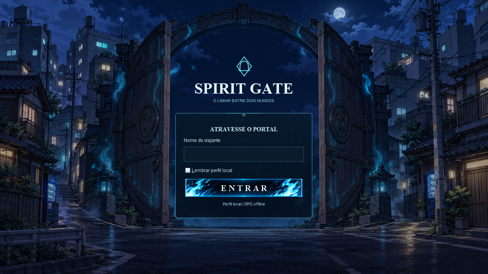

# Login — Portal Urbano escolhido

O modelo Portal Urbano foi escolhido após feedback e está ativo na entrada do jogo. O formulário foi ajustado para a abertura da porta: largura de 360 pixels, título de 40 pixels, painel de altura natural, moldura ciano discreta e fundo translúcido. O cabeçalho do formulário é “ATRAVESSE O PORTAL” e o campo recebe o rótulo “Nome do viajante”.



A imagem é uma captura por `printAll` do painel Swing real, não um mockup. A arte original do Portal Urbano e os modelos de teste foram preservados. Nenhuma nova imagem foi gerada nesta etapa.

O perfil local, a preferência de lembrar nome, a entrada na seleção e o botão estático existente continuam funcionando pelo mesmo fluxo. O modo permanece offline.

## Validação

7 testes passaram, sem falhas ou erros, incluindo `SpiritGateEntryTest`, `CharacterSelectionTest` e `CharacterSelectionVisualTest`. O teste da entrada verifica renderização e limites dos controles em 1280×720, 640×480 e 480×540, além da ação Entrar. Log: `.task-checkpoints/urban-login/tests-final.log`; checkpoint anterior em `before/`.

```powershell
mvn -o "-Dmaven.repo.local=$PWD/.maven-repository" -f server/pom.xml "-Dtest=SpiritGateEntryTest,CharacterSelectionTest,CharacterSelectionVisualTest" test
```

Para abrir, execute `jogar-rpg-offline.cmd` na raiz do projeto. As classes locais já foram recompiladas com a nova tela. O executável histórico em `dist/` não foi reempacotado.
