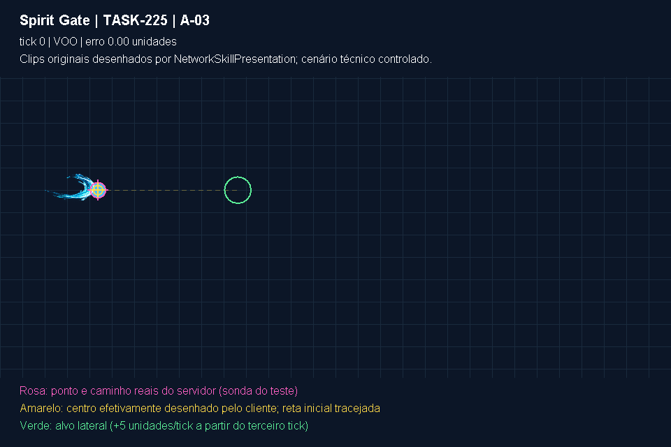
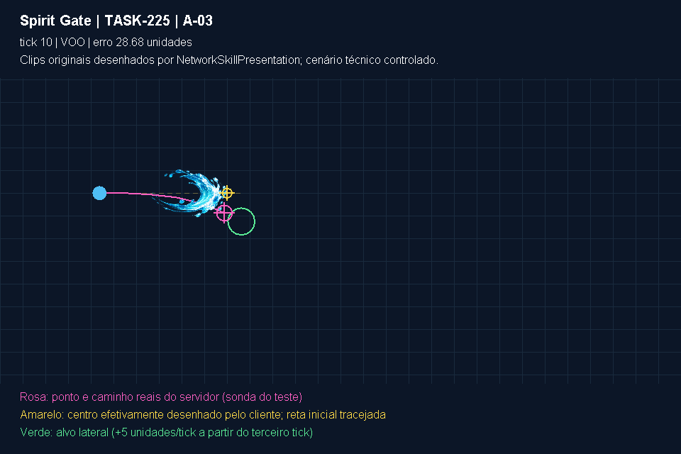
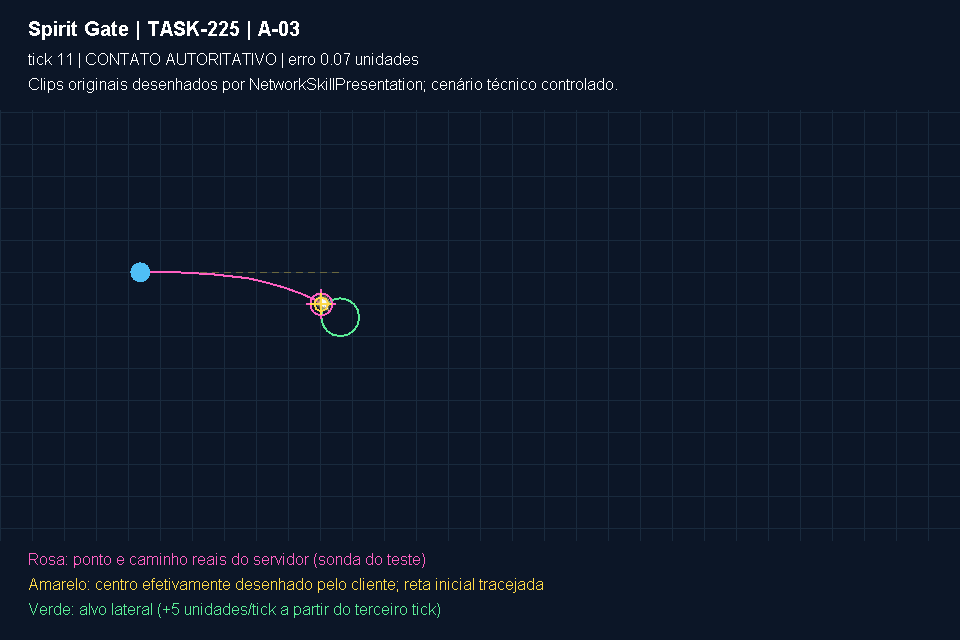

# TASK-225 — Projétil dirigido contra alvo lateral

Esta galeria é gerada por `Task225MovingProjectileVisualTest` com os clips originais carregados uma vez por `NetworkSkillPresentation.load`. O renderer do jogo produz o efeito; linhas, círculos, legenda e marcadores são instrumentos adicionais do teste. Não é uma captura de uma sessão Radmin, de dois computadores ou de homologação estética humana.

O cenário usa o executor real `RpgSkillEngine`: lançador em `(140, 300)`, `water_1` dirigido a um alvo inicialmente em `(340, 300)`, com 1.000 HP. Depois do segundo tick, o alvo se move lateralmente cinco unidades por tick. A posição é imposta no fixture para manter a sequência determinística; a IA não é executada. O encontro real permanece conectado para que o dano use o ledger existente. O cenário termina no primeiro contato e falha se não houver contato em menos de vinte ticks.

## Sequência

O teste grava `voo-00.png`, `voo-04.png`, `voo-08.png`, `voo-10.png` e `voo-<tick>-contato.png`. O tick terminal exato e as coordenadas são registrados em [trajetoria.json](trajetoria.json); todas as amostras ficam em [trajetoria.csv](trajetoria.csv). A execução, seu resultado e o valor medido devem ser consultados junto de `TASK-225-TESTES.md` e do log Maven do checkpoint.

Na execução de 03/11/2026, registrada em `moving-target.log`: **erro intermediário máximo de 28,676 unidades** no tick 10; **contato no tick 11 em `(321,054; 331,959)`**; erro raster terminal de **0,068 unidade**. O alvo está em `(340, 345)` no contato, e a distância até o ponto de colisão corresponde ao raio combinado de 23 unidades. O HP passa de 1.000 para 980 somente no contato.

| Lançamento | Voo e divergência | Contato confirmado |
|---|---|---|
|  |  |  |

Quadros intermediários: [tick 4](voo-04.png), [tick 8](voo-08.png).

- Azul: lançador fixo.
- Verde: hitbox circular do alvo em sua posição controlada atual.
- Rosa: posição e percurso do `Projectile` autoritativo, lidos por reflexão restrita ao código de teste.
- Amarelo: centro desenhado pela apresentação, com o segmento inicial tracejado.

O centro amarelo é medido por um segundo `NetworkSkillPresentation`, com um marcador raster conhecido no lugar do clip. Isso observa o cálculo de desenho efetivo sem duplicar sua fórmula. As imagens da galeria usam os clips reais, e não esse marcador. O CSV devolve a coordenada visual ao plano de apoio removendo somente a elevação visual de 28 pixels já estabelecida pelo jogo; admite-se até 1,5 unidade de arredondamento raster no contato.

## Interpretação e limites

O teste exige uma divergência intermediária superior a vinte unidades entre o projétil real que acompanha o alvo e o segmento inicial apresentado pelo cliente. Também exige que o efeito terminal se desenhe na coordenada do contato autoritativo, com arredondamento raster, e que repetir o mesmo frame não duplique nem reinicie o efeito. Depois da expiração, reenviar o mesmo estado retido não pode ressuscitar o impacto.

Os pontos rosas não são enviados ao cliente: a reflexão existe somente em `src/test`. O contrato da aplicação 7 continua transmitindo origem/destino do lançamento e evento terminal, sem ID de alvo, geração ou amostras intermediárias de trajetória. Esta galeria demonstra o risco A-03 e o acerto da posição terminal; não comprova uma trajetória intermediária sincronizada nem pretende substituir a negociação necessária para uma futura extensão do protocolo.

Nenhum PNG de skill é alterado. Esta sequência não testa latência de rede, perda de pacotes, carga do servidor, teclado físico ou movimentação real da IA. Esses aspectos têm evidências separadas quando efetivamente executados.
